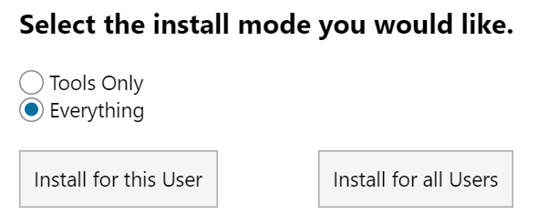
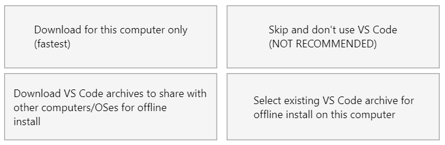
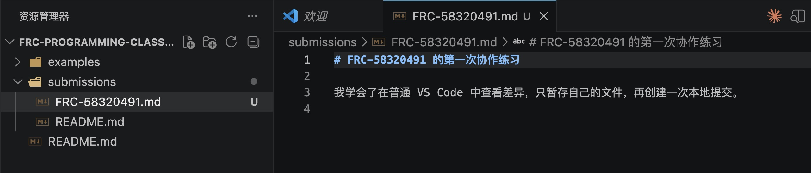
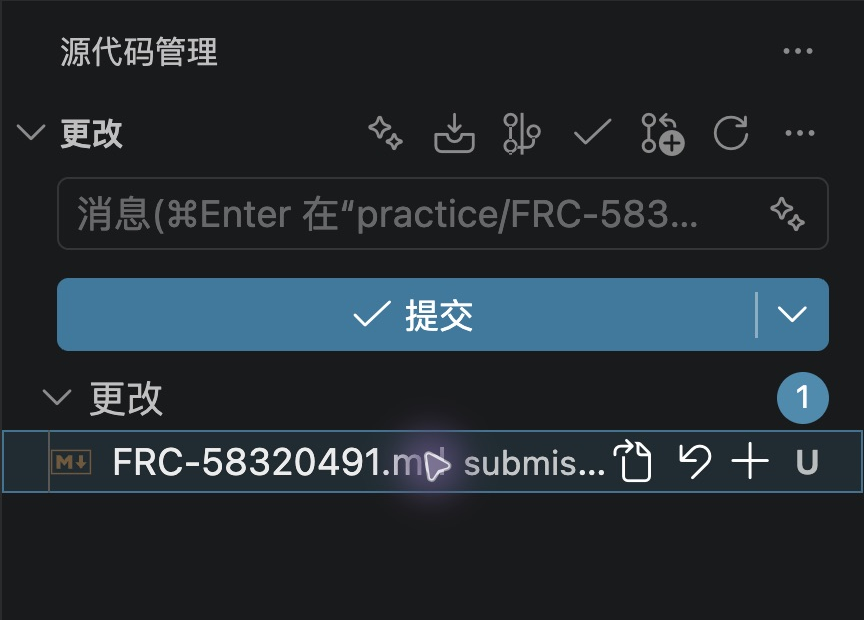
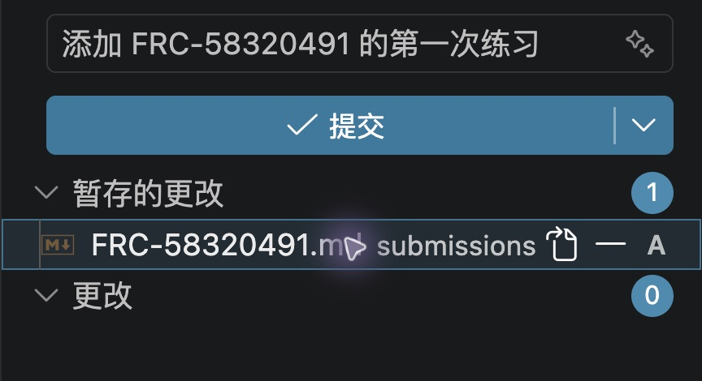
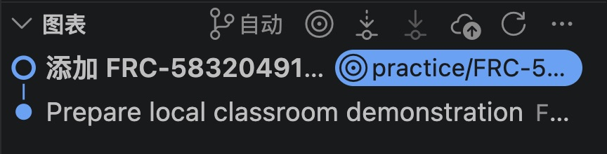

# FRC 编程环境与 GitHub 协作

**完整教程与作业**<br>
适用：第一次使用编程工具的同学<br>
课堂版本：WPILib `2027.0.0-alpha-6`<br>
更新日期：2026-11-13

[打开教师仓库][classroom] | [直接交作业][form] | [查看作业清单](#assignment)

先按自己的系统尝试安装，再提交真实进度截图。暂时不会写 Java，不影响这次练习。

| 内容 | 本次要求 | 要交什么 |
| :--- | :--- | :--- |
| 安装与环境检查 | 必须尝试，按实际进度提交 | 成功、报错或卡住步骤的截图 |
| GitHub Issue、PR | 选做，可以分项尝试 | 做到哪项就交对应截图，没做可留空 |
| 问卷星 | 必交 | 姓名、学号、随机学习代号、系统与截图 |

**不用另写 Word、PDF 或实验报告；不用等 PR 合并；不用连接或部署机器人。**

<a id="contents"></a>

## 目录与学习路线

| 顺序 | 阅读内容 | 适合谁 |
| :---: | :--- | :--- |
| 01 | [认识工具与操作位置](#prepare) | 所有人 |
| 02 | [软件下载、加速与校验](#downloads) | 所有人，按平台选文件 |
| 03 | [Windows 安装](#windows) | Windows 11 x64 |
| 04 | [macOS 安装](#macos) | Apple 芯片或 Intel Mac |
| 05 | [检查环境并留截图](#environment) | 所有人，成功或失败都记录 |
| 06 | [GitHub 账号与隐私准备](#identity) | 选做 GitHub 的同学 |
| 07 | [Fork、Clone 与练习分支](#repository) | 选做 GitHub 的同学 |
| 08 | [普通 VS Code 实拍：编辑、提交、推送](#vscode) | 选做 GitHub 的同学 |
| 09 | [创建 Issue 和 PR](#collaboration) | 选做 GitHub 的同学 |
| 10 | [作业、截图与问卷提交](#assignment) | 所有人 |
| 11 | [遇到问题怎样检查](#troubleshooting) | 按需查阅 |
| 12 | [后续练习与官方资料](#further-reading) | 学有余力时阅读 |

只交基础作业：读完第 01 至 05 节，直接去第 10 节。<br>
想练 GitHub：完成环境检查后，继续第 06 至 09 节。

在 GitHub 网页中，代码块右上角可复制代码。在 VS Code 中打开本文件后，用“打开预览”阅读：Windows 按 `Ctrl + Shift + V`，Mac 按 `Command + Shift + V`。手机上的宽表格可横向滑动。

<a id="prepare"></a>

## 01 认识工具与操作位置

### 1.1 这几个名字分别指什么

| 名称 | 做什么 | 本课要分清的事 |
| :--- | :--- | :--- |
| WPILib | 机器人开发工具套装，提供库、构建工具和配套编辑器 | 普通 VS Code 不能代替整套 WPILib |
| VS Code | 编辑文件、查看修改、使用终端 | 环境检查用 WPILib 配套版；文字练习可用普通版 |
| Java / JDK | Java 是编程语言；JDK 提供编译等工具 | 本课由 WPILib 安装器准备匹配的 JDK，不另找“最新版 Java” |
| Git | 在电脑上记录文件修改与版本 | 可以先在本地 Commit，不等于已经上传 |
| GitHub | 网上存放仓库、讨论问题、申请合并修改 | 登录网站不等于电脑装好了 Git |
| Markdown | 用纯文本写标题、列表、代码和链接 | `.md` 文件可直接编辑，不需要 Word |

### 1.2 先看电脑是否适用

| 平台 | 查看位置 | 本课要求 |
| :--- | :--- | :--- |
| Windows | 设置 > 系统 > 关于 | Windows 11，x64 处理器、64 位系统 |
| Mac：Apple 芯片 | 苹果菜单 > 关于本机，查看“芯片” | Apple M 系列，macOS 15 或以上 |
| Mac：Intel | 苹果菜单 > 关于本机，查看“处理器” | Intel，macOS 15 或以上 |

ARM Windows、32 位 Windows 或不符合要求的系统，先告诉老师。不要自行升级学校电脑，也不要为了本课给 Mac 另装 Windows。

建一个固定的**练习父文件夹**：Windows 可用 `D:\GitClass`，没有 D 盘就用 `C:\GitClass`；Mac 在个人文件夹中建 `GitClass`。机房不允许时请老师指定位置。尽量避开自动同步目录，不把整个桌面或下载目录当成仓库。

### 1.3 不要混用命令面板、终端和文件

| 位置 / 操作 | Windows | macOS |
| :--- | :--- | :--- |
| 命令面板，搜索编辑器操作 | `Ctrl + Shift + P` | `Command + Shift + P` |
| 终端，输入 Shell 命令 | 菜单“终端 > 新建终端”，使用 PowerShell | 同一菜单，使用默认 Shell |
| 保存文件 | `Ctrl + S` | `Command + S` |
| 区域截图 | `Win + Shift + S` | `Command + Shift + 4` |

| 教程示例 | 应放在哪里 |
| :--- | :--- |
| `WPILib: Create a new project`、`Git: Clone` | 命令面板搜索框 |
| `git --version`、`git status` | 终端 |
| `# 我的标题`、一句学习记录 | `.md` 文件正文 |

复制命令时保留空格与英文标点，一行一行执行。本教程代码块不带终端提示符，不要把三反引号也粘进去。遇到“换成自己的”时先替换，再执行。

<a id="downloads"></a>

## 02 软件下载、加速与校验

### 2.1 按系统选安装包

本课固定 **WPILib `2027.0.0-alpha-6`**。它是课堂指定测试版，不代表最新版本、稳定版或正式比赛方案。官网提示其他版本时，也不要自行替换。

| 软件 | 平台 / 用途 | 官方入口 |
| :--- | :--- | :--- |
| WPILib | Windows 11 x64，ISO | [下载 Windows 安装包][wpilib-win] |
| WPILib | Mac Apple 芯片，Arm64 DMG | [下载 Apple 芯片安装包][wpilib-arm] |
| WPILib | Mac Intel，Intel DMG | [下载 Intel 安装包][wpilib-intel] |
| Git | Windows x64 安装版 | [Git for Windows][git-win] |
| Git | Mac 安装说明 | [Git for Mac][git-mac] |
| 普通 VS Code | 本次 Markdown 文字练习 | [VS Code 下载][vscode-download] |

普通 VS Code 已能正常使用，就不用为文字练习重复安装。需要安装时，Windows 选 x64；Mac 按芯片选 Apple silicon 或 Intel，解压后放进 Applications。机器人环境仍要安装 WPILib 配套编辑器。

WPILib 文件较大，等浏览器显示下载完成再打开。检查文件名含 `2027.0.0-alpha-6`，平台与后缀正确；Windows 可在资源管理器“查看 > 显示 > 文件扩展名”核对。

发布说明、下载与系统要求以 [Alpha 6 官方发布页][wpilib-release]为准。[WPILib 安装指南][wpilib-install]可能随网站更新或重定向，不据此更换课堂版本。

### 2.2 GitHub 下载慢时的备用办法

学校允许使用第三方公开文件下载服务时，可尝试：

| 第三方入口 | 用法 |
| :--- | :--- |
| [ghfast](https://ghfast.top/) | 把官方 GitHub 文件下载链接粘进站点输入框 |
| [GH-Proxy](https://gh-proxy.com/) | 同上，保留原始下载链接 |

以已核对的 Git `2.56.1` Windows x64 安装包为例，下面分别是官方地址和备用地址。Git 的小版本不要求全班完全一致，之后优先从官方入口选合适版本。

```text
https://github.com/git-for-windows/git/releases/download/v2.56.1.windows.1/Git-2.56.1-64-bit.exe
```

```text
https://ghfast.top/https://github.com/git-for-windows/git/releases/download/v2.56.1.windows.1/Git-2.56.1-64-bit.exe
```

```text
https://gh-proxy.com/https://github.com/git-for-windows/git/releases/download/v2.56.1.windows.1/Git-2.56.1-64-bit.exe
```

这些站点不是 GitHub 或学校的服务，不保证速度、可用性或安装包安全性。只作公开文件下载备用，**不用于登录、Clone、Push、Issue 或 PR**。不输入密码、验证码、Token、私有链接或个人资料。

WPILib 上表的直链来自官方发布页，域名是 `packages.wpilib.workers.dev`，不是 GitHub 附件，**不要给它加 GitHub 加速前缀**。遇到证书警告、要求关闭防护、安装额外插件或付费解锁时，停止并找老师。

<details>
<summary>按需展开：核对 WPILib 安装包的 SHA256</summary>

SHA256 用来核对文件是否与官方公布的文件一致。下载完整后，计算结果与同平台的官方值逐位比较；不一致就停止安装。

Windows：PowerShell，先替换实际文件路径。

```powershell
Get-FileHash "C:\实际下载目录\WPILib_Windows-2027.0.0-alpha-6.iso" -Algorithm SHA256
```

Mac：终端输入 `shasum -a 256` 和空格，再把 DMG 从 Finder 拖进终端；或按下面格式替换路径。Intel Mac 要换成 Intel 文件名。

```bash
shasum -a 256 "/实际下载目录/WPILib_macOS-Arm64-2027.0.0-alpha-6.dmg"
```

官方值来源：[Alpha 6 发布页][wpilib-release]，复核日期 2026-11-13。

**Windows ISO**

```text
3f1c9f921c3747d8bbc3d36da6603c750ed2e04a27a1f4a6ae87c529d4f3144e
```

**Mac Apple 芯片 DMG**

```text
f6c9b5291ac383db082a45856a480a8dbe8c906696c3c960048547c579a1e2bf
```

**Mac Intel DMG**

```text
d2914b53f252f740ad848cca5f695c90234b2d40df71fd994330d14fe6a3be79
```

</details>

<a id="windows"></a>

## 03 Windows 安装

Mac 用户直接去 [第 04 节](#macos)，不用照做本节。

### 3.1 安装 Git

1. 从 [Git 官方入口][git-win]下载 x64 安装版，不选 Portable。
2. 运行安装器，多数选项保持默认。
3. 遇到下表选项时核对，再继续到安装完成。

| 选项 | 本课选择 |
| :--- | :--- |
| Default editor | 列表有 Visual Studio Code 时可选择它 |
| Initial branch name | 若提供自定义选项，可填 `main` |
| PATH environment | `Git from the command line and also from 3rd-party software` |
| Line ending conversions | 普通 Windows 安装保持默认，仓库规则优先 |
| Credential helper | 若出现，保留 Git Credential Manager |

保存已有文件，关闭所有 VS Code 窗口后再打开，让新窗口读取更新的 PATH。不要急着配置真实姓名和私人邮箱，GitHub 练习前会单独设置本仓库的提交身份。

### 3.2 安装 WPILib

1. 右键下载好的 ISO，选“挂载 / Mount”，打开新出现的虚拟光驱。
2. 运行 `WPILibInstaller.exe`，在欢迎页点 Start。
3. 选 **Everything**。个人电脑通常选 **Install for this User**；机房安装范围由管理员决定。



4. 到编辑器下载页，选 **Download for this computer only**。已有普通 VS Code，也安装课堂配套版，不选 Skip。



5. 等下载结束，按 Next 继续到完成，点 Finish。
6. 打开本次安装的 WPILib VS Code，继续 [第 05 节检查](#environment)。

两图为 WPILib 官方文档界面示例，图中年份不替代课堂版本。图片署名与许可见 [文末说明](#image-credits)。

没有“挂载”、被安全软件拦截或缺少管理员权限时，先让老师核对来源和机房策略。不要关闭杀毒软件、证书校验或学校管理设置。

<a id="macos"></a>

## 04 macOS 安装

### 4.1 准备 Apple 命令行工具

确认 macOS 至少为 15，并在“关于本机”看清 Apple 芯片或 Intel。打开“应用程序 > 实用工具 > 终端”，执行：

```bash
xcode-select --install
```

按 Apple 窗口提示安装，等结束后再继续。若提示已经安装，不重复安装。接着执行：

```bash
xcode-select -p
git --version
```

前者应返回开发者工具目录，后者应显示 Git 版本。即使已有 Git，也要确认命令行工具就绪后再运行 WPILib 安装器。本课不要求先装 Homebrew 或完整 Xcode。

### 4.2 安装匹配芯片的 WPILib

1. Apple M 系列下载 Arm64 DMG；Intel 处理器下载 Intel DMG，别选 Windows ISO。
2. 双击 `.dmg`，运行其中的 `WPILibInstaller`。
3. 选择 Everything，按提示安装配套 VS Code、JDK 和工具。
4. 需要下载编辑器时选 Download for this computer only，等安装完成。
5. 从安装器提供的位置打开 WPILib 配套 VS Code，可拖到 Dock 方便以后使用。
6. 继续 [第 05 节检查](#environment)。

遇到“无法验证开发者”、权限或学校管理限制时，停止并请老师核对。不要关闭 Gatekeeper 或其他安全设置，也不用为本次练习另装 Windows。

<a id="environment"></a>

## 05 检查环境并留截图

### 5.1 在正确的编辑器中检查

打开 **WPILib 配套 VS Code**，不要误开普通版或其他年份版本。先跳过不必要的设置同步，等待扩展加载，不连接机器人。

1. 菜单“终端 > 新建终端”，执行：

   ```sh
   git --version
   ```

   应显示 Git 版本，数字不必与同学完全相同。

2. 打开左侧“扩展”面板，在搜索框输入：

   ```text
   @installed WPILib
   ```

   注意是 `@installed`。确认 WPILib 扩展存在且没有被禁用。

3. 打开**命令面板**，搜索：

   ```text
   WPILib
   ```

   能找到 `WPILib: Create a new project` 等命令就行，不必点击创建项目。

### 5.2 保留当前进度

| 检查结果 | 截图方法 | 能否交作业 |
| :--- | :--- | :---: |
| 正常 | 底部保留 Git 版本结果，再打开 WPILib 命令面板，同图截取 | 可以 |
| 报错 | 截取相关操作位置与清楚的报错原文 | 可以 |
| 下载或权限卡住 | 截取当前卡住步骤，不伪造成功结果 | 可以 |

只截必要区域，遮盖个人路径、邮箱和无关标签页。安装失败也可以交，不用一口气重装所有软件。

看到扩展与命令，只说明基础工具能加载，不代表具体机器人工程构建成功；`java -version` 也不能单独证明 WPILib 使用了正确的 JDK。本次不要求 Build、Deploy 或驱动机器人。

**基础作业到这里已经有可交的进度凭据。** 不做 GitHub 选做时，直接去 [第 10 节提交](#assignment)。

<a id="identity"></a>

## 06 选做：GitHub 账号与隐私准备

### 6.1 用自己的账号，自选随机学习代号

在 [GitHub](https://github.com/) 登录符合学校安排及适用年龄要求的本人账号。注册、邮箱验证或登录受限时，私下告诉老师，不借用账号、不虚报信息、不绕过限制。密码和验证码只在官方登录流程中输入。

GitHub 用户名自己起昵称。课堂另选一个学习代号：

```text
FRC-加8位随机数字
```

例如 `FRC-58320491`。这是老师示范代号，**不能照抄**。不要用学号、生日、姓名拼音、班级座号、电话尾号，或由这些资料直接算出的编码。

去教师仓库的 `submissions` 文件夹和 Issues 搜索代号，重号就换一个。记下自己的代号，文件名、分支、提交署名、Issue、PR 和问卷都保持一致；不用找老师领取。

### 6.2 先打开邮箱隐私设置

1. 在 GitHub 点头像 > Settings > Emails。
2. 开启 `Keep my email addresses private`。
3. 复制页面实际提供的完整 `noreply` 邮箱，不猜格式。
4. 若有 `Block command line pushes that expose my email`，可开启。
5. 不截图公开这一页；只开启网页选项，还不会改变本机 Git 邮箱。

姓名和学号只填给老师的问卷，不写进公开 GitHub。代号不保证匿名，公开用户名、头像、提交邮箱、历史活动仍可能关联身份。官方说明：[设置提交邮箱][commit-email]。

<a id="repository"></a>

## 07 选做：Fork、Clone 与练习分支

### 7.1 Fork 教师仓库

打开 [教师仓库][classroom]，核对拥有者与名称：

```text
ZaneZhang-MINXIN / frc-programming-classroom
```

1. 确认右上角是自己的账号，点右上方 Fork。
2. Owner 选择自己，仓库名保持 `frc-programming-classroom`。
3. 可保留 Copy the main branch only，点 Create fork。
4. 跳转后，仓库拥有者应变为自己的用户名。已有 Fork 时打开现有那份，不反复创建。

| 操作 | 从哪里到哪里 |
| :--- | :--- |
| Fork | 教师的 GitHub 仓库复制到你的 GitHub 账号 |
| Clone | 你的 Fork 克隆到电脑 |
| Commit | 在电脑上记下一次版本 |
| Push | 电脑上的提交发送到自己的 Fork |
| PR | 申请把自己的改动合并进教师仓库 |

不需要老师把你加成教师仓库的协作者。官方阅读：[Fork 仓库][fork-doc]。

### 7.2 Clone 自己的 Fork

1. 在**自己 Fork 的页面**点 Code > HTTPS，复制地址。地址拥有者必须是自己，不是老师。
2. 打开普通 VS Code，在命令面板搜索并运行 `Git: Clone`。
3. 粘贴地址，按 Enter，选择第 01 节建好的 `GitClass` 父文件夹。
4. 克隆结束点 Open，打开自动生成的 `frc-programming-classroom` 子文件夹。
5. 出现信任提示时，核对来源是本课仓库后再信任。

不要选 Download ZIP 代替 Clone，也不要只打开父文件夹或单个 `.md` 文件。左侧应能看到 `README.md`、`docs`、`examples` 和 `submissions`。

在该窗口的新终端执行：

```sh
git status
git remote -v
```

应能看到仓库状态；`origin` 的 fetch / push 地址都指向自己的 Fork。两行表示远程的两种用途，不是两个仓库。

若显示 `not a git repository`，先重新打开克隆后的子文件夹；不要执行 `git init`，以免把无关文件纳入仓库。

### 7.3 设置本次仓库的提交身份

先确认终端在刚克隆的仓库里。下列内容**替换后再执行**：代号改为自己的，邮箱改为第 06 节复制的完整 `noreply` 邮箱。不能把中文占位说明原样当邮箱。

```sh
git config --local user.name "FRC-58320491"
git config --local user.email "换成自己的完整GitHub noreply邮箱"
```

再核对实际作者身份：

```sh
git var GIT_AUTHOR_IDENT
```

结果应是自己的代号与 `noreply` 邮箱；仍出现别人姓名或私人邮箱就停止提交，请老师检查。结果仅在自己电脑上看，不截图公开。

`--local` 只设置当前仓库，不改其他项目默认身份；这不是登录命令，也不会改变 GitHub 用户名。修改配置只影响后续提交，不会清除旧提交中的姓名或邮箱。

### 7.4 创建练习分支

1. 点击 VS Code 左下角的 `main`，选 Create new branch / 创建新分支。
2. 输入 `practice/自己的学习代号`，例如 `practice/FRC-58320491`。
3. 若询问起点，选 `main`。
4. 核对左下角已切换到自己的 `practice/...` 分支，再开始改文件。

<details>
<summary>终端备用：与界面方法二选一，不要重复建分支</summary>

把代号换成自己的后执行：

```sh
git switch -c practice/FRC-58320491
git branch --show-current
```

分支已存在时，选择已有分支，不继续重复创建。

</details>

<a id="vscode"></a>

## 08 选做：普通 VS Code 实拍操作

四张图来自老师本机 Mac 的**普通 VS Code 实际操作**，只示范到本地提交，没有连接远程或替学生创建 Issue、PR。Windows 的按钮相近，快捷键按第 01 节区分；不用照装图里的其他插件。

### 8.1 写自己的一个 Markdown 文件

1. 展开 `examples`，打开 `FRC-EXAMPLE.md` 看格式，不修改示例。
2. 在 `submissions` 文件夹上右键 > New File / 新建文件。
3. 文件名填 `自己的学习代号.md`，例如 `FRC-58320491.md`。不要变成 `.md.txt`。
4. 写入下列格式，把代号和句子换成自己实际学到的操作，保存。

```markdown
# FRC-58320491 的第一次协作练习

我学会了查看文件差异，只暂存自己的文件，再创建一次本地提交。
```

第一行的 `#` 加空格是 Markdown 标题，写进文件正文，不是终端命令。最终路径应为：

```text
submissions/自己的学习代号.md
```



*实拍 1：左侧核对文件位置，右侧是已保存的内容。示例代号和句子不原样交作业。*

本次只新增自己的文件，不改其他同学文件、教程、README 或模板，不添加截图、安装包和整份机器人工程。

### 8.2 检查差异，只暂存自己的文件

1. 点击左侧“源代码管理”图标，找到自己的文件。
2. 点文件查看差异。绿色通常表示新增，红色表示删除；分屏是版本比较，不是要保存两份。
3. 核对更改列表没有无关内容，再点**自己文件这一行**的 `+`。



*实拍 2：`U` 表示新文件尚未被 Git 跟踪，不是报错。点文件行的 `+`，不点“全部暂存”或“放弃更改”。*

暂存后，文件进入 Staged Changes / 暂存的更改。新文件常显示 `A`；`M` 常表示已修改。

### 8.3 创建一次本地 Commit

在源代码管理消息框写清这次修改，例如：

```text
添加 FRC-58320491 的第一次练习
```

替换代号，核对暂存文件后点 Commit / 提交。



*实拍 3：确认“暂存的更改”只有自己的文件，再提交。*

若打开 `COMMIT_EDITMSG`，在第一行写提交说明、保存并关闭该标签页，等待提交结束。随后在终端检查：

```sh
git status
git log -1 --oneline
```

应看到工作区干净，例如 `nothing to commit, working tree clean`，日志中能找到刚刚的提交。



*实拍 4：已产生本地提交，但还没上传。这张示范图不是学生完成作业的凭据。*

| 动作 | 结果 | 是否上传到 GitHub |
| :--- | :--- | :---: |
| Save / 保存 | 写入电脑文件 | 否 |
| Stage / 暂存 | 选出这次要提交的修改 | 否 |
| Commit / 提交 | 记入本地 Git 历史 | 否 |
| Push / 推送 | 把提交发送到远程仓库 | 是 |

### 8.4 Push 到自己的 Fork

1. 点 Publish Branch / 发布分支；没有此按钮时，从源代码管理 `...` 菜单选 Push / 推送。
2. 如询问远程，选指向自己 Fork 的 `origin`。
3. 如需认证，按提示在官方 GitHub 页面登录本人账号，不把密码或 Token 写进文件。
4. 打开自己 Fork 的网页，切换到 `practice/自己的代号`。
5. 打开 `submissions`，确认文件与最新提交已出现。

网页仍在 `main` 时看不到练习分支的文件是正常的，先切分支，不重复建文件。若编辑器要求“Publish to GitHub”并新建仓库，先取消，检查是否打开了正确克隆。

<details>
<summary>终端备用：首次推送当前练习分支</summary>

先用 `git remote -v` 确认 `origin` 是自己的 Fork。替换分支代号后执行：

```sh
git push -u origin practice/FRC-58320491
```

`-u` 建立远程跟踪关系，以后同一分支通常可直接 Push。报错时不加 `--force`。

</details>

官方阅读：[VS Code 源代码管理][vscode-git]。

<a id="collaboration"></a>

## 09 选做：创建 Issue 和 PR

### 9.1 在教师仓库提 Issue

打开[教师仓库 Issues][issues]，核对拥有者是 `ZaneZhang-MINXIN`，不是自己的 Fork。

1. 点 New issue，选择“课堂提问或建议”表单。
2. 标题写自己的代号和主题，例如：

   ```text
   [课堂练习] FRC-58320491 Commit 后为什么还要 Push
   ```

3. 填代号、问题类型、具体问题，以及已尝试的操作或目前理解。
4. 检查没有身份资料、个人路径、凭据或截图，勾选隐私检查后发布。
5. 记下 Issue 编号，复制网页链接备用。不必等老师回复。

一个有用的问题要说清“哪一步、看见什么、想知道什么”。没有报错可以提真实的概念问题或改进建议，不编造故障，也不只写“已完成”“不会”。

官方阅读：[创建 Issue][issue-doc]。

### 9.2 向教师仓库创建 PR

在自己的 Fork 切到练习分支，点 Compare & pull request。没有提示时，进入教师仓库 Pull requests > New pull request > compare across forks。

| 字段 | 正确选择 |
| :--- | :--- |
| base repository | `ZaneZhang-MINXIN/frc-programming-classroom` |
| base | `main` |
| head fork / head repository | 你自己的 Fork |
| compare | `practice/自己的学习代号` |

方向是**自己的练习分支合并到教师 `main`**。你只提出申请，是否合并由老师决定。

1. 查看差异，只应新增自己的 `submissions/代号.md`。出现大量删除或其他同学文件时先停止。
2. 标题写自己的代号与修改主题，例如 `[课堂练习] FRC-58320491 完成第一次提交`。
3. 填写自动出现的 PR 模板，不上传截图。
4. 点 Create pull request，创建普通 PR。
5. 打开 Files changed，再次确认只改自己的一个文件。

| 模板部分 | 本次怎样填 |
| :--- | :--- |
| Summary | 自己的学习代号、练习文件路径 |
| 关联 Issue | 做了就填链接；没做就写“暂未完成”，不编造链接 |
| Evidence | 按实际差异核对：新增自己的文件，没有无关修改 |
| Merge Danger | 本次是可撤销的小范围文档修改，保留相关说明，逐项核对检查框 |

官方阅读：[从 Fork 创建 PR][pr-doc]。

### 9.3 检查状态与后续修改

| 状态 | 含义 | 截图凭据 |
| :--- | :--- | :--- |
| Open | 已创建，等待检查或合并 | 可以交 |
| Merged | 老师已合并 | 可以交 |
| Closed，未合并 | 申请关闭，但修改未被接收 | 如实说明，不冒充合并成功 |

老师要求修改时，回到**同一个练习分支**，修改、保存、暂存、Commit、Push，原 PR 会更新，不必重新创建。出现冲突先问老师，不用强制推送、删除别人内容或 `reset --hard` 解决。

教师未回复或未合并，不影响你提交问卷。本仓库没有配置 GitHub Actions，不用为凑绿色检查而添加工作流、上传 Token 或改仓库设置。

<a id="assignment"></a>

## 10 作业、截图与问卷提交

### 10.1 本次实际要做什么

| 类别 | 任务 | 完成标准 |
| :--- | :--- | :--- |
| 必交 | 尝试安装并检查环境 | 第 5 题交自己的成功、报错或卡住步骤截图 |
| 选做 | 一个 Issue | 在教师仓库写真实问题或具体建议 |
| 选做 | 一个 PR | 指向教师 `main`，只修改自己的代号文件 |
| 必交 | 填写问卷并提交 | 身份信息、系统、必交截图与提交确认填写完整 |

三项 GitHub 截图可以留空。不借用同学账号、记录或截图，不需要声称已经完成全部选做。

### 10.2 入口与二维码

**[点击打开：FRC 编程环境与 GitHub 作业提交][form]**

<a href="https://v.wjx.cn/vm/YR3nxKS.aspx"></a>

电脑可直接点链接，手机可扫码。二维码与文字链接指向同一问卷。

### 10.3 按实际题目填写

| 题号 | 题目 | 是否必填 | 填写 / 截图要求 |
| :---: | :--- | :---: | :--- |
| 1 | 你的姓名 | 是 | 真实姓名，仅填给老师的问卷 |
| 2 | 你的学号 | 是 | 保留开头的 `0`，不是随机学习代号 |
| 3 | 本次作业的学习代号 | 是 | 自选 `FRC-` 加 8 位随机数字 |
| 4 | 这次作业使用的电脑系统 | 是 | Windows 11 x64 / macOS Apple 芯片 / macOS Intel / 其他或不确定 |
| 5 | 环境检查截图 | 是 | 成功：Git 版本与 WPILib 命令；未成功：报错或卡住步骤 |
| 6 | Issue 截图 | 否 | 教师仓库名称、Issue 标题与编号、代号及具体问题 |
| 7 | PR 概览截图 | 否 | 教师仓库名称、PR 标题与编号、代号、状态与合并方向 |
| 8 | PR 文件差异截图 | 否 | **PR 网页的 Files changed**，只显示自己的文件，内容清楚 |
| 9 | 提交确认 | 是 | 检查实际进度与隐私后勾选，不要求声称完成 GitHub |
| 10 | 补充截图 | 否 | 需要补充画面时使用 |

### 10.4 截图怎么拍、怎么命名

Windows 用 `Win + Shift + S`，Mac 用 `Command + Shift + 4`。每道上传题 **最多 1 个文件、最大 10 MB，仅 PNG / JPG / JPEG**。

| 截图 | 操作要点 | 文件名示例，代号自行替换 |
| :--- | :--- | :--- |
| 环境 | 底部 Git 版本 + WPILib 命令面板；失败则截当前问题 | `FRC-58320491-环境.png` |
| Issue，选做 | 展示教师仓库中自己已发布的 Issue，不是编辑草稿 | `FRC-58320491-Issue.png` |
| PR 概览，选做 | 保留状态与合并方向，不用等合并 | `FRC-58320491-PR.png` |
| PR 差异，选做 | 截 GitHub Files changed，不用本地编辑器图代替 | `FRC-58320491-差异.png` |

一张图装不下就用第 10 题补图，不拼成看不清的长图。截图只交问卷，不上传到仓库、Issue、PR 或自己的公开 Fork，不用姓名或学号命名。

### 10.5 提交前检查

- [ ] 姓名、学号、学习代号正确，学号没有丢开头的 `0`。
- [ ] 第 5 题是自己的真实进度截图；尚未成功也可以交。
- [ ] 第 6 至 8 题按实际进度填写，没有借用别人的凭据。
- [ ] 图中文字清楚，裁掉无关聊天、窗口和网页标签。
- [ ] 遮盖个人路径、邮箱、密码、验证码、Token 等信息。
- [ ] 截图和身份信息没有放进公开 GitHub。
- [ ] 看清第 9 题后再勾选，点击提交并确认出现成功提示。

提交成功不代表已经批改。保留电脑中的原始截图，补交与截止安排以老师通知为准，不另交报告。

公用电脑使用结束后，退出 GitHub 网页和 VS Code 账户，按机房要求处理缓存凭据。只关窗口不一定退出，不会清理时请老师协助。

<a id="troubleshooting"></a>

## 11 遇到问题怎样检查

| 现象 | 先做什么 | 不要做什么 |
| :--- | :--- | :--- |
| 找不到 `git` | Windows 确认已装 Git，关闭所有 VS Code 再重开；PowerShell 用 `Get-Command git` 检查。Mac 检查 Apple 命令行工具 | 不随意删除 PATH |
| 找不到 WPILib 命令 | 核对编辑器年份与版本，扩展面板搜 `@installed WPILib`，确认启用 | 不急着装另一套扩展 |
| Java 一直加载或报运行时错误 | 记录原提示；机器人工程要打开根目录，请老师核对运行时 | 不盲改 `JAVA_HOME` 或另装 JDK |
| `not a git repository` | 打开 Clone 后的 `frc-programming-classroom` 子文件夹 | 不在父目录执行 `git init` |
| `Author identity unknown` | 按 7.3 配置当前仓库，并核对实际作者身份 | 不用重新注册账号 |
| 新文件找不到 | 检查是否已保存、位置是否为 `submissions`、是否打开另一份克隆 | 不到处复制同名文件 |
| Commit 后网页没更新 | 先 Push，再检查自己 Fork 的练习分支 | 不以为 Commit 等于上传 |
| Push 报 `403` / `permission denied` | 看 `git remote -v` 的 `origin` 拥有者及实际认证账号 | 不直接往教师仓库 Push |
| Push 被 `rejected` | 保存现有工作，记录原提示，请老师指导整合 | 不强推、不丢弃本地修改 |
| PR 没差异或有大量无关文件 | 核对 Push、base、compare 与暂存范围 | 不靠复制别人文件制造差异 |
| Issue 发到自己 Fork | 去教师仓库重新提交，在误发 Issue 中说明后关闭 | 不把误发记录当成已发对位置 |
| 网络、账号或权限卡住 | 留相关画面，按真实进度交问卷 | 不共享账号或绕过学校规定 |

求助时可按下面顺序说清楚，只私下发必要画面：

```text
系统与芯片：
教程章节：
刚刚做的操作：
出现的提示原文：
已经尝试的办法：
```

不要在公开 Issue 粘贴含个人路径或凭据的整段日志。发现姓名、邮箱或凭据已公开时，停止继续转发，私下联系老师；密码或 Token 泄露要立即撤销或更换。删掉当前文件，不代表历史与所有副本都已清除。

<a id="further-reading"></a>

## 12 后续练习与官方资料

<details>
<summary>选学：老师更新仓库后，怎样同步到电脑</summary>

先保存、Commit、Push 自己的改动，确认工作区干净。

1. 在自己 Fork 网页切到 `main`，点 Sync fork，把教师 `main` 的更新同步进来。
2. 回到本地，切到 `main`，再 Pull。
3. 下次练习从更新后的 `main` 创建新分支，不每次重新克隆。

本课 `origin` 是自己的 Fork；同步 Fork 与本地 Pull 是两步。出现冲突或丢弃提交提示时停止，先找老师。

</details>

<details>
<summary>选学：按老师安排构建真实机器人工程</summary>

本仓库只有协作练习，不是机器人控制工程。打开老师已验证的工程根目录，通常能看到 `build.gradle`、`gradlew`、`gradle` 和 `.wpilib`。

等待 Java / Gradle 扩展加载，在命令面板运行 `WPILib: Build Robot Code`。只有输出 `BUILD SUCCESSFUL`，才能说这次具体工程构建成功。

Build 在电脑上构建；Deploy 会把程序上传机器人，两者不同。本次不要求 Deploy。设备镜像、WPILib 与厂商库由老师核对，不自行刷镜像、混换 Alpha 或复制旧年份依赖；没有老师明确指令，不连接、部署、启用或驱动机器人。

参考：[Systemcore 官方测试与兼容信息](https://github.com/wpilibsuite/SystemcoreTesting)。

</details>

按眼前的问题选一份读，不用一次读完：

| 想弄清什么 | 官方资料 | 建议先读 |
| :--- | :--- | :--- |
| 本课版本、安装文件与系统要求 | [WPILib Alpha 6 发布页][wpilib-release] | Downloads、System Requirements、SHA256 |
| 安装器每个选项做什么 | [WPILib 安装指南][wpilib-install] | 安装步骤；版本仍以课堂固定要求为准 |
| VS Code 中怎样查看和提交修改 | [VS Code 源代码管理][vscode-git] | Changes、Staging、Commit |
| 如何预览 Markdown | [VS Code Markdown 文档](https://code.visualstudio.com/docs/languages/markdown) | Preview、标题导航 |
| 标题、列表、链接与任务清单 | [GitHub 基础排版语法](https://docs.github.com/en/get-started/writing-on-github/getting-started-with-writing-and-formatting-on-github/basic-writing-and-formatting-syntax) | Basic formatting |
| 代码块怎样标注语言 | [GitHub 代码块语法](https://docs.github.com/en/get-started/writing-on-github/working-with-advanced-formatting/creating-and-highlighting-code-blocks) | 三反引号与语言名称 |
| Fork、Issue、PR 的正式说明 | [Fork][fork-doc] / [Issue][issue-doc] / [从 Fork 创建 PR][pr-doc] | 与本次操作对应的步骤 |
| Git 的基本概念 | [Pro Git 中文版](https://git-scm.com/book/zh/v2) | 第 1 章概念、第 2 章基础 |
| Java 语言入门 | [Dev.java 官方教程](https://dev.java/learn/) | Your First Steps、Language Basics |

<a id="image-credits"></a>

### 图片来源与说明

安装器图片来自 [WPILib 官方安装文档][wpilib-install]，署名 WPILib 文档贡献者，采用 [CC BY 4.0](https://creativecommons.org/licenses/by/4.0/) 许可；本文件使用按钮区域裁切，未改动界面文字。[原图 1](https://docs.wpilib.org/en/2027/_images/installer-options.png)、[原图 2](https://docs.wpilib.org/en/2027/_images/installer-vscode-download.png)及[许可声明](https://github.com/wpilibsuite/frc-docs/blob/main/license.txt)可供对照。

四张普通 VS Code 图为老师于 2026-11-12 在独立本地示范仓库中的实拍，未连接远程；裁切仅用于聚焦操作区域和避免公开本机路径。二维码由老师于 2026-11-13 提供，已核对指向本次问卷。所有示例图都不是学生作业凭据。

[返回目录](#contents) | [回到作业清单](#assignment) | **[提交问卷][form]**

[classroom]: https://github.com/ZaneZhang-MINXIN/frc-programming-classroom
[issues]: https://github.com/ZaneZhang-MINXIN/frc-programming-classroom/issues
[form]: https://v.wjx.cn/vm/YR3nxKS.aspx
[wpilib-release]: https://github.com/wpilibsuite/allwpilib/releases/tag/v2027.0.0-alpha-6
[wpilib-install]: https://docs.wpilib.org/en/2027/docs/zero-to-robot/step-2/wpilib-setup.html
[wpilib-win]: https://packages.wpilib.workers.dev/installer/v2027.0.0-alpha-6/Win64/WPILib_Windows-2027.0.0-alpha-6.iso
[wpilib-arm]: https://packages.wpilib.workers.dev/installer/v2027.0.0-alpha-6/macOSArm/WPILib_macOS-Arm64-2027.0.0-alpha-6.dmg
[wpilib-intel]: https://packages.wpilib.workers.dev/installer/v2027.0.0-alpha-6/macOS/WPILib_macOS-Intel-2027.0.0-alpha-6.dmg
[git-win]: https://git-scm.com/install/windows
[git-mac]: https://git-scm.com/install/mac
[vscode-download]: https://code.visualstudio.com/Download
[vscode-git]: https://code.visualstudio.com/docs/sourcecontrol/overview
[commit-email]: https://docs.github.com/en/account-and-profile/how-tos/email-preferences/setting-your-commit-email-address
[fork-doc]: https://docs.github.com/en/pull-requests/how-tos/work-with-forks/fork-a-repo
[issue-doc]: https://docs.github.com/en/issues/tracking-your-work-with-issues/using-issues/creating-an-issue
[pr-doc]: https://docs.github.com/en/pull-requests/how-tos/create-pull-requests/creating-a-pull-request-from-a-fork
