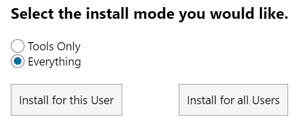
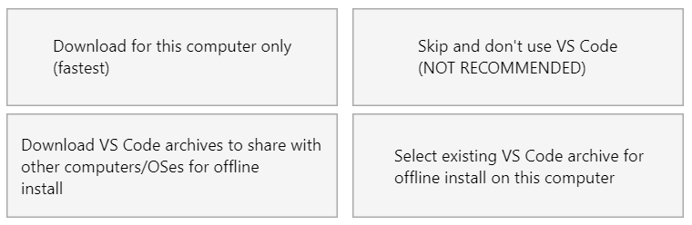
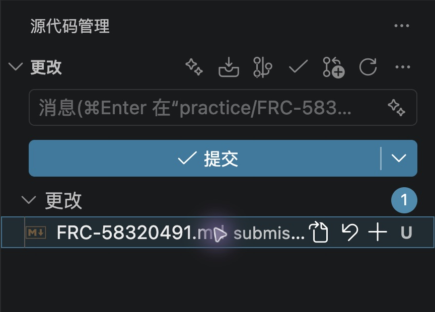
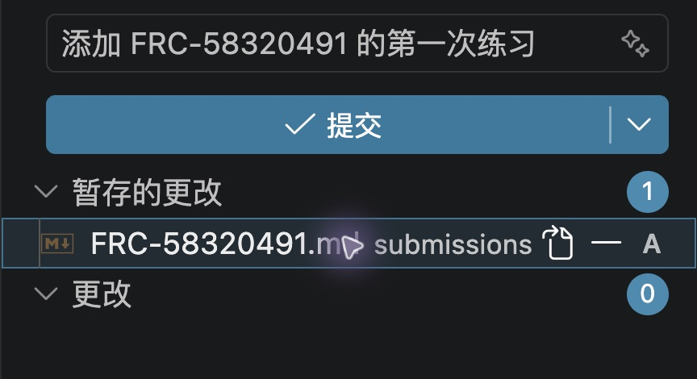

# FRC 编程环境安装与 GitHub 协作详细教程

面向第一次使用编程工具的学生

课堂版本 2026 年 11 月 12 日

先装好课堂要用的工具，再把一个小文件通过 GitHub 交给老师。现在不会写 Java 也没关系，作业只需改一段文字。每做完一节，核对页末的检查结果，再往下走。

本课固定使用 WPILib 2027.0.0-alpha-6。Windows 电脑需要 Windows 11 x64，Mac 需要 macOS 15 或以上，并按芯片选择安装包。Alpha 6 是测试版，不是最新或稳定版，也不能直接当作正式比赛的安装方案。网页推荐了更新版本，也先别换。

安装和检查机器人开发环境时，打开配套的 WPILib VS Code。写本次 Markdown 作业可以用普通 VS Code，本教程后半部分有老师在 Mac 上用普通 VS Code 操作的实拍图。

**教师仓库**

[打开 FRC 编程课堂](https://github.com/ZaneZhang-MINXIN/frc-programming-classroom)

浏览器地址应为 `github.com/ZaneZhang-MINXIN/frc-programming-classroom`。进入后应看到仓库名 `frc-programming-classroom`。

## 本课路线

| 阶段 | 对应章节 | 完成后你能做什么 |
| --- | --- | --- |
| 认识工具和准备电脑 | 01 至 03 | 分清软件、网页、文件夹和账户 |
| 安装并检查环境 | 04 至 07 | 找到 WPILib 命令，运行 Git 版本检查 |
| 完成一次协作 | 08 至 18 | Fork、克隆、提交、提问并发出 PR |
| 跟着实拍图练习 | 第 18 节后 | 在普通 VS Code 中编辑、检查、暂存和提交 |
| 按需查阅 | 19 至 22 | 检查老师工程、处理常见问题、查官方资料 |
| 最后作业 | 23 | 实际完成 Issue 和 PR，准备问卷星要交的截图 |

作业凭据只交截图，不另写报告。GitHub 上的 Issue 和 PR 仍要实际创建。老师公布问卷星入口后，再按题目上传截图，不放进公开仓库。

遇到问题时，先记下“哪一节、做了什么、出现什么提示”。不要一口气重装所有软件，也不要尝试强制推送或关闭电脑安全设置。

<!-- page -->

## 01 先认识这几个工具

### WPILib 是机器人开发工具套装

WPILib 提供机器人程序使用的库、构建工具和编辑器配套配置。完整安装器会准备配套 VS Code、JDK 和扩展。只装一个普通 VS Code，不能说明机器人开发环境已经装好。

### VS Code 是你编辑文件的地方

你会在这里打开文件夹、修改文件、查看 Git 修改和使用终端。本次文字作业可以用普通 VS Code；安装检查和机器人工程使用配套 WPILib VS Code。两种编辑器可以同时存在，做环境检查时别开错。

### Java 和 JDK 是不同层面的名称

Java 是本课机器人程序使用的编程语言。JDK 是包含编译器等工具的开发套件。完整 WPILib 安装器会配置匹配的 JDK，不必为了本课另外随便下载一个 Java 版本。

### Git 在电脑上记录修改

Git 可以把文件修改记成一个个版本。你安装 Git 后，即使暂时没有网络，也可以在本地提交。Git 不等于 GitHub。

### GitHub 是网上的协作平台

GitHub 保存远程仓库，也提供 Issue 和 Pull Request。浏览器能登录 GitHub，不代表电脑已经安装 Git；电脑装了 Git，也不代表已经登录 GitHub。

| 名称 | 你会在哪里看到它 | 本课用途 |
| --- | --- | --- |
| 本地仓库 | 电脑上的文件夹 | 编辑和提交 |
| 教师仓库 | 老师的 GitHub 页面 | 教程、接收 PR 和 Issue |
| 你的 Fork | 你账号下的 GitHub 页面 | 保存你推送的练习 |
| 分支 Branch | 本地和 GitHub 都有 | 单独进行一次修改 |
| Issue | GitHub 网页 | 提出问题或建议 |
| PR | GitHub 网页 | 请老师检查并接收修改 |

**成功标志：** 你能说清“我正在改电脑上的文件，还是正在看 GitHub 网页”，并知道本次先推送到自己的 Fork，再向老师发 PR。

<!-- page -->

## 02 准备电脑和练习文件夹

### 检查 Windows 和处理器类型

1. 按键盘上的 Windows 键，打开“设置”。
2. 进入“系统”，再打开“关于”。
3. 看 Windows 版本是否为 Windows 11。
4. 在“系统类型”中确认是 x64 处理器的 64 位系统。

Windows 如果写着 ARM、ARM64 或 32 位，先告诉老师，不能直接装 x64 安装包。Alpha 6 不支持 ARM Windows。Mac 用户看本页后面的说明，选择 Mac 安装路线。

### 准备一个固定位置

在文件资源管理器中创建 `D:\GitClass`；没有 D 盘时，创建 `C:\GitClass`。如果机房不允许你在这些位置建文件夹，请老师指定一个允许写入的位置。

这个文件夹是“父文件夹”。克隆后，里面会自动出现 `frc-programming-classroom` 子文件夹。不要把整个桌面、下载目录或磁盘根目录变成 Git 仓库。

Mac 用户在 Finder 的个人文件夹中创建 `GitClass`，不要照输 `D:\GitClass`。点左上角苹果菜单，打开“关于本机”，查看系统版本及“芯片”或“处理器”：Apple M 系列选 Arm64，Intel 选 Intel。本课 Alpha 6 要求 macOS 15 或以上，系统太旧就先告诉老师，不要自行升级学校电脑。

尽量不用会自动同步的文件夹，减少同步软件干扰 Git。以后打开同一份克隆，不必每节课复制一份。

### 认清三种操作位置

| 教程中的说法 | 在哪里操作 | 怎样打开 |
| --- | --- | --- |
| 浏览器 | Edge、Chrome 等网页窗口 | 打开教程给出的网页链接 |
| 命令面板 | VS Code 顶部弹出的搜索框 | `Ctrl + Shift + P` |
| 终端 | VS Code 下方可以输入命令的区域 | 在“终端”菜单中点“新建终端” |

`WPILib: Create a new project` 在命令面板搜索；`git --version` 在终端执行。Mac 的命令面板快捷键是 `Command + Shift + P`，保存是 `Command + S`。文中的 Windows 快捷键不能全部照搬到 Mac；拿不准时用菜单打开。

**输入命令的方法：** 使用英文半角标点，命令中的空格也要保留。一次输入一行，按 Enter 执行。不要把教程中展示的 `PS D:\...>` 等提示符当成命令；本教程的代码块不包含这些提示符。

**成功标志：** 系统类型确认完成，练习父文件夹已经建好。

<!-- page -->

## 03 准备 GitHub 账号和学习代号

### 使用自己的课堂账号

1. 在浏览器打开 [GitHub](https://github.com/)。
2. 已有符合学校要求的账号就点 Sign in；没有账号时按老师安排注册。
3. 完成邮箱验证。密码和验证码只在官方登录页面输入，不发给老师或同学。
4. 检查右上角头像菜单，确认登录的是自己的账号，不是上一个使用这台电脑的人。

注册须符合 GitHub 适用年龄要求和学校安排。达不到要求或学校未允许注册时，请老师安排替代活动，不虚报信息、不借用他人账号。

### 自己选昵称和随机学习代号

GitHub 用户名自己起一个不含身份信息的昵称，不用找老师领取。已经有账号也可以继续用，但要先检查公开资料里有没有不想公开的信息。

再给这次练习选一个“FRC-加 8 位随机数字”的学习代号，例如 `FRC-58320491`。例子不要照抄，也不要把生日或学号当随机数。开始前到教师仓库的 `submissions` 和 Issues 搜索这个代号；若已有人使用，就换一个。

文件名、分支名、Issue 和 PR 都用同一个代号。记下来，最后在老师的问卷星表单里也填它。不要把真实学号、姓名拼音、班级加座号或电话尾号写到 GitHub。

### 打开邮箱隐私设置

1. 在 GitHub 右上角点击头像，再点 Settings。
2. 在侧栏找到 Emails。
3. 找到并开启 Keep my email addresses private。
4. 复制页面提供的 `noreply` 邮箱，暂时保存在自己能找到的私密位置。
5. 若页面提供 Block command line pushes that expose my email，可开启它，增加一次保护。

不要照猜邮箱格式。第 10 节会把这个邮箱写进本次仓库的 Git 设置。只开启网页隐私选项，不会自动修改电脑上的 Git 邮箱。

**公开页面上的用户名、头像和历史活动仍然可见。** 随机代号只是减少直接暴露，不保证匿名。不要在 GitHub 个人简介中为了这节课再填写真实学校班级或联系方式。

**成功标志：** 已选好用户名和学习代号，找到自己的 `noreply` 邮箱。不公开截图这一页。

<!-- page -->

## 04 下载课堂指定的 WPILib

### 只进入指定版本的官方发布页

打开 [WPILib 2027 Alpha 6 官方发布页](https://github.com/wpilibsuite/allwpilib/releases/tag/v2027.0.0-alpha-6)。

先看页面标题和地址，确认包含 `v2027.0.0-alpha-6`。不要直接下载页面可能推荐的 Latest 版本，也不要把其他年份的 WPILib 当成本课版本。

### 按电脑选择安装包

Windows 11 x64 在 Downloads 区域选择 Windows，下载：

```text
WPILib_Windows-2027.0.0-alpha-6.iso
```

这是约 2.6 GB 的磁盘映像文件。Mac 不用 ISO：Apple 芯片选 Mac (Arm)，Intel 处理器选 Mac (Intel)，对应的文件名分别为 `WPILib_macOS-Arm64-2027.0.0-alpha-6.dmg` 和 `WPILib_macOS-Intel-2027.0.0-alpha-6.dmg`。

下面三个地址来自该版本的官方发布页，可直接点击下载：

Windows x64：[下载 Windows ISO](https://packages.wpilib.workers.dev/installer/v2027.0.0-alpha-6/Win64/WPILib_Windows-2027.0.0-alpha-6.iso)

Mac Apple 芯片：[下载 Arm64 DMG](https://packages.wpilib.workers.dev/installer/v2027.0.0-alpha-6/macOSArm/WPILib_macOS-Arm64-2027.0.0-alpha-6.dmg)

Mac Intel：[下载 Intel DMG](https://packages.wpilib.workers.dev/installer/v2027.0.0-alpha-6/macOS/WPILib_macOS-Intel-2027.0.0-alpha-6.dmg)

完整地址另列在仓库的 [软件下载清单](downloads.md)，方便复制。提前接通电源，留出足够空间，等浏览器显示下载完成再打开。

安装器后面还可能下载 VS Code，所以仅下载 ISO 不代表已经准备好所有安装内容。网络受限时，请老师提供按官方说明准备的离线材料。

### 下载完成后做一次核对

1. 在浏览器下载列表中选择“在文件夹中显示”。
2. 核对文件名，不要误用旧年份、另一个 Alpha 或 macOS 的 `.dmg`。
3. Windows 若隐藏扩展名，在文件资源管理器的“查看”菜单中打开“显示”，勾选“文件扩展名”。

**可选核验：** 老师要求检查文件完整性时，在 PowerShell 输入下面的命令，并把路径改成你实际下载的位置。

```powershell
Get-FileHash "C:\下载目录\WPILib_Windows-2027.0.0-alpha-6.iso" -Algorithm SHA256
```

将结果与官方发布页中对应平台的 SHA256 比较，必须逐位一致。Mac 用 `shasum -a 256`，具体命令见后面的 macOS 安装补充。核验不过就停止安装，不要只看文件名相同就继续。

**成功标志：** 文件已完整下载，版本和平台均正确。

<!-- page -->

## 下载补充 普通 VS Code 与 Git

### 普通 VS Code

官网：[https://code.visualstudio.com/Download](https://code.visualstudio.com/Download)

Windows 电脑选 Windows x64 安装版。Mac 按“关于本机”显示的芯片选择 Apple silicon 或 Intel，解压后放进 Applications。已经能正常打开普通 VS Code，就不用为这次文字作业再装一份。

普通 VS Code 负责编辑本次 `.md` 文件就够了。它不会因为能提交 Git，就自动具备 WPILib 机器人工程所需的 JDK 和扩展；机器人环境仍按第 05、06 节检查。

### Windows 上安装 Git

官方入口：[https://git-scm.com/install/windows](https://git-scm.com/install/windows)

本次核对到的 x64 安装包是 [Git 2.56.1 官方直链](https://github.com/git-for-windows/git/releases/download/v2.56.1.windows.1/Git-2.56.1-64-bit.exe)。Git 的小版本不用和同学完全一致，之后优先从官方入口选合适版本。安装选项见第 07 节。

### Mac 上先检查 Git

官方说明：[https://git-scm.com/install/mac](https://git-scm.com/install/mac)

打开“终端”，输入 `git --version`。已经显示版本就不用重复安装。若提示安装命令行开发者工具，可按下一页的 macOS 步骤处理；本次不要求先安装 Homebrew。

### 不必单独下载 Java

本课用 WPILib 安装器准备匹配的 JDK。不要在搜索引擎中随便下载一个“最新版 Java”，然后拿它替换课堂环境。普通 Markdown 作业本身不需要运行 Java。

<!-- page -->

## 下载补充 GitHub 文件加速

官方直链下载太慢、且学校允许使用第三方下载服务时，可试下面两个入口：

1. [https://ghfast.top/](https://ghfast.top/)
2. [https://gh-proxy.com/](https://gh-proxy.com/)

这两处是第三方服务，不是 GitHub 或学校提供的站点。2026 年 11 月 12 日核对时，入口及公开小文件下载可访问；不保证你所在网络的速度，也没有做课堂批量大文件下载测试。

### 怎样用

先在软件官方发布页复制真正的下载链接，再粘贴到加速站的输入框。也可以在原链接前加入口前缀，保留原有的 `https://`。例如，本次 Git for Windows 安装包的加速链接为：

[通过 ghfast 下载 Git 2.56.1 x64](https://ghfast.top/https://github.com/git-for-windows/git/releases/download/v2.56.1.windows.1/Git-2.56.1-64-bit.exe)

[通过 GH-Proxy 下载 Git 2.56.1 x64](https://gh-proxy.com/https://github.com/git-for-windows/git/releases/download/v2.56.1.windows.1/Git-2.56.1-64-bit.exe)

完整地址见 [软件下载清单](downloads.md)。不要把普通 GitHub 仓库首页当安装包地址，也不要把加速地址配置成作业仓库的 `origin`。

### 哪些内容不能放进去

只用来下载公开文件。不要在加速站登录 GitHub，不输入账号密码、验证码、Token、私有仓库链接或学校内部材料。它不能替你完成登录、Push、Issue 或 PR。

WPILib Alpha 6 的安装包实际来自官方发布页链接的 `packages.wpilib.workers.dev`，不是 GitHub Releases 附件。保留上页的官方直链，不要在它前面硬加 GitHub 代理前缀。

下载后核对文件名，并按官方发布页检查校验值；Windows 的 Git 安装包还应检查文件属性中的数字签名。不要运行加速站另外推荐的软件。证书警告、文件类型不对或要求关闭安全软件时，停止下载，请老师检查。

<!-- page -->

## 05 安装 WPILib 和配套 VS Code

本页是 Windows 步骤。Mac 用户跳到下一页的 macOS 安装补充，再回来继续第 06 节。

1. 右键刚下载的 ISO，点“挂载 Mount”。打开新出现的虚拟光驱。
2. 运行其中的 `WPILibInstaller.exe`，在欢迎页点 Start。
3. 选择 **Everything**。个人电脑通常选择 **Install for this User**；机房是否安装给所有用户，由管理员决定。



图 1 官方安装器选项局部。认准 Everything 与安装范围。

4. 到 VS Code 页面，选择 **Download for this computer only**。不要选 Skip and don't use VS Code。



图 2 官方安装器界面示例。已有普通 VS Code，也应按课堂要求安装配套版本。

5. 等下载结束，按 Next 继续，直到安装完成，再点 Finish。

如果没有“挂载”，或遇到安全拦截、管理员限制，先请老师核对来源和电脑策略。不要为完成安装而关闭杀毒软件、证书检查或学校安全管理。

**成功标志：** 安装器完成，电脑上出现这套 WPILib 的 VS Code 启动入口。还要继续完成第 06 节检查，不能只凭图标判断成功。

<!-- page -->

## macOS 安装补充

### 先装命令行开发者工具

Alpha 6 要求 macOS 15 或以上。确认芯片和系统版本后，打开“应用程序”中的“实用工具”，运行“终端”：

```bash
xcode-select --install
```

若出现 Apple 安装窗口，按提示安装并等待结束。若提示工具已安装，不必重复。再执行：

```bash
xcode-select -p
git --version
```

前者应返回开发者工具目录，后者应返回 Git 版本。机房限制安装或系统不符合要求时，先找老师。

### 安装匹配芯片的 WPILib

1. Apple M 系列下载 Arm64 DMG，Intel 处理器下载 Intel DMG。
2. 下载结束后双击 `.dmg`，打开其中的 WPILib 安装器。
3. 在 WPILib 安装界面选择 Everything，按提示安装配套 VS Code 和工具。
4. 需要下载编辑器时，选择 Download for this computer only，等待完成。
5. 安装完成后打开配套的 WPILib VS Code，按第 06 节检查扩展和命令。

遇到“无法验证开发者”、权限或学校管理限制，不关闭 Gatekeeper 或其他安全设置。请老师核对官方来源和安装策略。不要下载 Windows ISO，也不要为了本课另装 Windows。

### 按需检查下载完整性

终端先输入 `shasum -a 256` 和一个空格，再把 DMG 从 Finder 拖进终端，按 Enter。这样不用手打可能带空格的完整路径。

```bash
shasum -a 256 "/实际路径/WPILib安装包.dmg"
```

把结果与 Alpha 6 官方发布页中同名文件的 SHA256 逐位比较，Arm64 与 Intel 的值不能混用。完整校验值也列在下载清单中。

本次只检查 Git 和 WPILib 命令，不要求在 Mac 上运行 Driver Station、连接机器人或部署代码。

<!-- page -->

## 06 打开正确的编辑器并检查扩展

### 打开课堂指定的 WPILib VS Code

1. Windows 从开始菜单或桌面找到本次安装的 WPILib VS Code；Mac 打开安装器生成的对应应用入口。
2. 第一次启动时可以先跳过主题、同步设置和账户登录等非必要欢迎步骤。
3. 等待扩展加载完成。如果老师指定的快捷方式名称仍显示 `2027_alpha5`，不要只凭名称断定装错；让老师结合 Alpha 6 安装记录和工程版本核对。

不要把普通 VS Code 的设置同步到 WPILib VS Code。你也不需要先连接机器人来检查编辑器。

### 检查 WPILib 扩展

点击左侧扩展图标，或在 Windows 按 `Ctrl + Shift + X`、Mac 按 `Command + Shift + X`，在搜索框输入：

```text
@installed WPILib
```

注意是 `@installed`，不是 `@install`。找到已安装的 WPILib 扩展，确认没有被禁用。搜索不到时先核对编辑器，别急着装另一套扩展。

Windows 按 `Ctrl + Shift + P`，Mac 按 `Command + Shift + P`，打开命令面板，输入 `WPILib`。看到 `WPILib: Create a new project` 等命令，按 Esc 退出。这里只检查命令，不创建项目。

### 中文界面和 Java 支持

想用中文界面，可在扩展面板搜索 `Chinese (Simplified) Language Pack`，确认发布者为 Microsoft，按提示安装、重启。

完整环境通常已配好 Java 支持。若出现 Java 扩展报错或没有 Java 支持，先请老师核对。需要补装时，认准 Microsoft 的 `Extension Pack for Java`，不要自行更换 JDK。

**检查边界：** 看到 WPILib 命令，证明扩展可以加载，不等于 Java 项目已成功构建。终端中的 `java -version` 也不能单独证明 WPILib 使用了正确的 JDK。

**成功标志：** 指定编辑器能打开，WPILib 扩展已启用，命令面板能找到 WPILib 命令。

<!-- page -->

## 07 安装 Git 并检查是否可用

本页安装步骤针对 Windows。Mac 用户按 macOS 安装补充准备 Git，再执行本页的版本检查就行。

### 下载 Git for Windows

打开 [Git for Windows 官方下载入口](https://git-scm.com/install/windows)，选择 Windows x64 安装版。初学者不需要选择 Portable 便携版。

运行安装器。大部分选项保持默认；遇到下列页面时再核对：

| 安装选项 | 本课怎样选 |
| --- | --- |
| Default editor | 若列表有 Visual Studio Code，可选择它 |
| Initial branch name | 若出现自定义选项，可填写 `main` |
| PATH environment | 选择 Git from the command line and also from 3rd-party software |
| Line ending conversions | 普通 Windows 安装保持默认，仓库规则优先 |
| Credential helper | 若出现，保留 Git Credential Manager |

### 重新打开编辑器

安装 Git 后，保存已有文件，关闭所有 VS Code 窗口，再打开课堂指定的 WPILib VS Code。这样新打开的进程才有机会读取更新的 PATH。

在“终端”菜单中点“新建终端”。Windows 使用 PowerShell 就行，不必切换成 Git Bash。Mac 使用自带的终端 Shell。输入：

```powershell
git --version
```

你应看到类似 `git version 2.x.x.windows.x` 的结果。数字以自己电脑为准，不必和同学完全相同。

若提示“无法将 git 识别为命令”，先确认 Git 安装完成、所有编辑器已重开，再执行 `Get-Command git` 检查路径。仍找不到时请老师处理，不自行删除系统 PATH。

**不要在这里先填真实姓名和私人邮箱。** 第 10 节会在本次仓库中设置学习代号和 `noreply` 邮箱。

**成功标志：** 终端能够显示 Git 版本。到这里，安装部分的基本检查完成。

<!-- page -->

## 08 在 GitHub 上 Fork 教师仓库

### 先认清你要复制哪一个仓库

在浏览器打开 [教师仓库](https://github.com/ZaneZhang-MINXIN/frc-programming-classroom)。页面上方应显示：

```text
ZaneZhang-MINXIN / frc-programming-classroom
```

这是全班共同参考的原仓库。你没有教师仓库的直接写入权限也能做本次练习，不需要老师把全班加为协作者。

### 创建自己的 Fork

1. 确认右上角登录的是自己的 GitHub 账号。
2. 点击仓库右上方的 Fork。较窄窗口中可能要先展开菜单。
3. Owner 选择自己的账号，仓库名保持 `frc-programming-classroom`。
4. 如果页面提供 Copy the main branch only，保留这个选项即可。
5. 点击 Create fork，等待跳转。

完成后，页面上方的拥有者应变成你的 GitHub 用户名。仓库附近通常还会显示它 Fork 自教师仓库。

### Fork 不等于克隆

Fork 先在 GitHub 上建立你的副本，电脑上还没有它的文件。下一节才把自己的 Fork 克隆到电脑。

| 操作 | 从哪里到哪里 |
| --- | --- |
| Fork | 教师 GitHub 仓库到你的 GitHub 账号 |
| Clone | 你的 GitHub 仓库到你的电脑 |
| Push | 电脑上的提交到你的 GitHub 仓库 |
| PR | 申请把你的修改合并进教师仓库 |

如果页面提示你已经有 Fork，直接打开现有那份即可，不必反复创建。若账号本身就是教师账号，请退出并换回学生自己的账号。

**成功标志：** 你能在自己的账号下打开该仓库，且能确认它来自教师仓库。

<!-- page -->

## 09 把自己的 Fork 克隆到电脑

### 复制自己仓库的地址

在浏览器打开**你自己的 Fork**，不要停留在教师仓库。点绿色 Code 按钮，选择 HTTPS，再点复制地址按钮。

检查地址中的拥有者是你自己的 GitHub 用户名。本次不要使用 Download ZIP；ZIP 是普通文件包，不是带完整 Git 工作信息的克隆。

### 在编辑器中克隆

1. 打开普通 VS Code，或已装好的配套 WPILib VS Code。两者都能做本次文字作业，选定后尽量一直用同一个窗口。
2. 按 `Ctrl + Shift + P`，搜索并选择 `Git: Clone`。
3. 粘贴刚复制的 HTTPS 地址，按 Enter。
4. 选择第 02 节准备的父文件夹，例如 `D:\GitClass`。
5. 等待完成，点击 Open 打开克隆后的仓库。

程序会自动创建 `frc-programming-classroom` 子文件夹。应打开这个子文件夹，而不是只打开 `D:\GitClass`，更不要只打开一个 `.md` 文件。

若出现工作区信任提示，仅在确认来源为本课已核对的仓库后选择信任。网页或终端要求认证时，核对官方 GitHub 登录页面和自己的账户，不分享验证码。

### 检查你是否进入正确位置

左侧资源管理器应出现 `README.md`、`docs`、`examples` 和 `submissions`。在该窗口打开新终端，依次输入：

```powershell
git status
git remote -v
```

第一条应显示当前分支和工作区状态。第二条中的 `origin` 地址应指向**你自己的 Fork**。`fetch` 和 `push` 两行不是两个仓库，而是同一远程地址的两种用途。

如果出现 `not a git repository`，先检查是否打开克隆后的文件夹。不要用 `git init` 把错误的父目录临时变成仓库。

**成功标志：** 文件夹打开正确，`origin` 指向自己的账号。以后通常直接打开这份文件夹即可。

<!-- page -->

## 10 设置本次提交使用的代号和邮箱

### 在克隆后的仓库中设置

登录 GitHub 后，Git 仍可能沿用这台电脑以前的提交署名。下面只设置本次仓库，不改其他项目的默认配置。

先确认终端仍在刚克隆的仓库中。把下面第一行的代号换成自己的，把第二行引号内的内容换成第 03 节复制的实际 `noreply` 邮箱。

```powershell
git config --local user.name "FRC-58320491"
git config --local user.email "复制自己的GitHub noreply邮箱"
```

上面第二行是替换说明，不能原样执行。`--local` 表示只设置这个仓库；本课不要求使用 `--global` 改整台电脑的默认署名。

### 核对实际提交身份

依次执行：

```powershell
git config --local --get user.name
git config --local --get user.email
git var GIT_AUTHOR_IDENT
```

前两条显示刚设置的值，最后一条显示 Git 当前实际采用的作者身份。如果最后一条仍显示别人姓名或私人邮箱，先停下来请老师检查，不要提交。

**不要把这些结果作为公开截图上传。** `noreply` 邮箱减少邮箱暴露，但仍可能包含账号相关信息。设置代号不会更改你的 GitHub 用户名或头像。

### 公用电脑特别注意

每次使用前都确认 GitHub 登录账户和仓库内的署名。不能因为昨天同学能推送，今天就直接沿用。完成后按机房要求退出账户并清理缓存凭据。

如果已经用私人邮箱提交过，修改配置只影响后续提交，不会自动修改旧历史。先请老师处理；不要自行强制推送或认为“再提交一次”就能遮住旧邮箱。

**成功标志：** Git 实际作者身份使用自己的学习代号和正确的 GitHub `noreply` 邮箱。

<!-- page -->

## 11 创建自己的练习分支

### 为什么先建分支

本课把默认的 `main` 留作参照，在自己的练习分支上修改。分支名也只使用学习代号，不写真实学号。

先执行 `git status`。刚克隆且尚未改动时，应看到工作区干净，通常会出现 `nothing to commit, working tree clean`。

### 使用 VS Code 创建分支

1. 点击窗口左下角显示的 `main`。
2. 在弹出列表中选择 Create new branch 或“创建新分支”。
3. 输入 `practice/你的学习代号`，例如 `practice/FRC-58320491`。
4. 按 Enter。若询问从哪个分支创建，选择当前的 `main`。
5. 再看左下角，确认已切换到新分支。

也可以在终端使用下面的命令。**界面方法和命令方法选一种即可，不要把同一分支创建两次。**

```powershell
git switch -c practice/FRC-58320491
```

这条命令同时完成“创建”和“切换”。`-c` 不是代号的一部分。换成你自己的代号后再执行。

### 再检查一次

```powershell
git branch --show-current
git status
```

第一条应显示自己的 `practice/...` 分支。暂时没有修改文件是正常的，建分支本身不会自动改变文件内容。

如果提示分支已经存在，不要继续重复创建。点击左下角选择已有分支，或请老师帮你确认以前是否已做过这一步。

**成功标志：** 当前分支为自己的练习分支，工作区仍然干净。

<!-- page -->

## 12 新增自己的一个练习文件

### 先看示例 再复制到正确目录

1. 在左侧资源管理器展开 `examples`，打开 `FRC-EXAMPLE.md`。
2. 阅读里面的一句学习记录。它只说明本次练习格式，不是交作业的报告。
3. 选中并复制示例内容。
4. 在 `submissions` 文件夹上右键，选择 New File 或“新建文件”。
5. 文件名输入自己的学习代号加 `.md`，例如 `FRC-58320491.md`。
6. 粘贴内容，把标题中的 `FRC-EXAMPLE` 换成自己的代号。
7. 将学习句子改成自己实际学会的一项操作，删除示例底部的提示注释。
8. 按 `Ctrl + S` 保存。

完成后的内容可以像下面这样，必须换成自己的代号和句子：

```markdown
# FRC-58320491 的第一次协作练习

我学会了创建练习分支，并把一次提交推送到自己的 Fork。
```

`.md` 表示 Markdown 文本文件。第一行开头的 `#` 加空格表示标题；这里的 `#` 是文件内容，不是在终端运行的命令。

### 核对文件位置

从仓库根目录看，路径应为：

```text
submissions/FRC-58320491.md
```

不要把文件建到 `examples`，不要改 `submissions/README.md`，不要把文件变成 `.md.txt`。若新建位置或名字不正确，先用资源管理器的重命名或移动功能修正。

**本次不要添加截图。** 环境截图、Issue 截图和 PR 截图留到最后，交学校作业平台。

**成功标志：** `submissions` 中出现自己的一个文件，内容没有示例代号、真实姓名或学号。

<!-- page -->

## 13 保存 暂存和本地提交

### 先看清楚改了什么

点左侧“源代码管理”图标，或按 `Ctrl + Shift + G`。在 Changes 或“更改”中找到自己的文件。新文件旁可能显示 `U`，表示尚未被 Git 跟踪；修改后的已跟踪文件可能显示 `M`。

点文件查看差异。绿色通常表示新增，红色通常表示删除。左右分屏是在比较版本，不是要求你保存两份文件。正常编辑时可以回到左侧资源管理器打开文件。

### 只暂存自己的文件

把鼠标移到自己的文件上，点击旁边的 `+`。文件应移到 Staged Changes 或“暂存的更改”。如果出现其他文件，先核对原因，不要直接“全部暂存”。

### 创建一次提交

在源代码管理的消息框输入说明，例如“添加 FRC-58320491 的第一次练习”，点击 Commit 或“提交”。

如果弹出 COMMIT_EDITMSG 标签页，在第一行写提交说明，保存后关闭这个标签页，等待提交完成。以 `#` 开头的提示行不用修改。

提交后执行：

```powershell
git status
git log -1 --oneline
```

状态应为工作区干净；日志应显示刚刚那次提交。**到这里仍然只保存在电脑的 Git 历史中，还没有上传到 GitHub。**

| 动作 | 完成了什么 | 是否已经上传 |
| --- | --- | --- |
| Save 保存 | 把编辑内容写入电脑文件 | 否 |
| Stage 暂存 | 选出本次准备提交的修改 | 否 |
| Commit 提交 | 记入电脑上的 Git 历史 | 否 |
| Push 推送 | 把本地提交发往远程仓库 | 是 |

**成功标志：** 能看到自己的最新提交，工作区干净。下一节再推送。

<!-- page -->

## 14 把提交推送到自己的 Fork

### 第一次发布分支

在源代码管理中点击 Publish Branch 或“发布分支”。如果没有这个按钮，从源代码管理的 `...` 菜单选择 Push 或“推送”。

如果询问远程仓库，选择指向自己 Fork 的 `origin`。若有 GitHub 登录提示，按浏览器提示完成认证，检查是自己的账号。不要把 GitHub 密码或 Token 写进文件。

如果你克隆的仓库已经有 `origin`，却看见“Publish to GitHub”并让你新建仓库，先取消，核对打开的是否为正确克隆目录。

### 终端备用方法

没有合适按钮时，可在老师指导下执行以下命令，分支名换成自己的：

```powershell
git push -u origin practice/FRC-58320491
```

这里 `origin` 应是自己的 Fork；`-u` 为当前分支建立后续推拉使用的跟踪关系。以后在同一分支通常可以直接使用 Push。

### 去网页核对结果

1. 在浏览器打开自己的 Fork，刷新页面。
2. 在文件列表上方的分支选择器中，从 `main` 切换到自己的 `practice/...`。
3. 打开 `submissions`，确认自己的文件已经出现。
4. 查看最近提交，确认是刚写的说明。

默认网页可能仍展示 `main`。文件只在练习分支出现是正常的，不要因此再建一份文件或重复提交。

如果报 403 或 permission denied，先核对 `git remote -v` 和登录账户。你能读教师仓库，不代表能直接往里面推送。正确路线是“推到自己的 Fork，再发 PR”。

**成功标志：** 自己 Fork 的练习分支上能看到文件和最新提交。教师仓库暂时没有该文件也正常。

<!-- page -->

## 15 在教师仓库提交一个 Issue

### Issue 用来说明问题

Issue 可以是报错、概念问题或具体建议。没有遇到故障，也可以提出一个自己真的想弄清楚的问题。不要编造报错，不要只写“已完成”。

### 进入正确的仓库

1. 打开 [教师仓库的 Issues 页面](https://github.com/ZaneZhang-MINXIN/frc-programming-classroom/issues)。
2. 核对拥有者为 `ZaneZhang-MINXIN`，不是你自己的账号。
3. 点击 New issue。
4. 选择“课堂提问或建议”表单；若出现 Get started，点击它。

### 逐项填写

标题中写学习代号和具体主题，例如：

```text
[课堂练习] FRC-58320491 Commit 后为什么还要 Push
```

学习代号填自己选的随机代号。问题类型按实际选择。正文写清“我在哪一步、看见什么、想知道什么”，再写一两句你已经尝试的操作或目前理解。

一个清楚的概念问题可以这样描述：我在第 13 节完成 Commit，电脑上的日志已有新记录，但 GitHub 网页仍没有文件。我理解 Commit 在本地，想确认是不是必须再执行 Push。请用自己的话提问，不必照抄示例。

### 发布前最后看一遍

检查标题和正文没有姓名、学号、私人邮箱、电脑个人路径、密码或验证码。不要上传截图，作业截图留在学校平台。勾选隐私检查后，点击 Submit new issue 或 Create。

发布后记住页面上的编号，例如 `#12`，并复制这个 Issue 的网页地址。下一节可把它填进 PR。

**成功标志：** 教师仓库里能看到自己的 Issue、学习代号和具体问题。无需等待老师回复后才继续。

<!-- page -->

## 16 向教师仓库创建 Pull Request

### PR 是一份合并申请

你已经把提交推送到自己的 Fork。现在请老师检查这份改动，并决定是否合并到教师仓库。学生不需要直接获得教师仓库写权限。

### 打开创建页面

回到自己的 Fork，切换到练习分支。若看到 Compare & pull request，点击它。若没有，进入教师仓库的 Pull requests，点 New pull request，再选择 compare across forks。

### 核对合并方向

| 页面字段 | 应选择什么 |
| --- | --- |
| base repository | `ZaneZhang-MINXIN/frc-programming-classroom` |
| base | `main` |
| head repository 或 head fork | 你自己的 `frc-programming-classroom` Fork |
| compare | 你自己的 `practice/学习代号` 分支 |

记住方向是“自己的练习分支进入教师 main”。若反过来，就不是本次要交的 PR。

### 检查差异并填写模板

向下查看文件差异，应只新增自己的 `submissions/学习代号.md`。如果出现其他同学文件、教程或大量删除，先不要创建。

标题写“[课堂练习] 学习代号 完成第一次提交”。正文通常自动带出模板：填写学习代号和文件路径，在关联 Issue 处粘贴上一节复制的地址，再核对 Evidence 和检查框。不要上传作业截图。

模板中的 Summary 是修改概述，Evidence 是检查依据，Merge Danger 是改动风险。本次只是自己的一个文本文件，可保留模板中“可撤销的文档改动”的说明。

点击 Create pull request，选择普通 PR 即可。老师尚未查看时显示 Open 是正常的，不要为交作业自己关闭或删除 PR。

**成功标志：** 教师仓库出现自己的 PR 编号和标题，合并方向正确。

<!-- page -->

## 17 检查 PR 并按老师意见修改

### 创建后检查这三个地方

在 PR 页面看 Conversation，确认学习代号和关联 Issue 已填好。打开 Commits，确认有自己刚做的提交。打开 Files changed，确认只包含自己的一个 `.md` 文件。

若看到其他人的提交或很多无关文件，先告诉老师，不要点击任何强制覆盖或删除操作。

### 老师要求修改时怎么做

1. 回到原来编辑作业的 VS Code 窗口。
2. 核对当前仍为这份 PR 的 `practice/...` 分支。
3. 打开自己的文件，按意见修改，按 `Ctrl + S`。
4. 在源代码管理检查差异，只暂存自己的文件。
5. 写新的提交说明，Commit，然后 Push。
6. 刷新原来的 PR 页面，查看新提交和差异。

**不必重新创建 PR。** 同一来源分支推送新提交后，原来的 PR 会更新。给老师回一条简短评论，说明已改好即可。

### 认清 PR 状态

| 状态 | 表示什么 | 是否可作本次提交凭据 |
| --- | --- | --- |
| Open | 已创建，等待检查或合并 | 可以 |
| Merged | 老师已经接收并合并 | 可以 |
| Closed 未合并 | 申请已关闭，但改动未合并 | 先向老师说明原因 |

有些页面会显示暂无自动检查，因为本仓库没有配置 GitHub Actions。不要为了让页面出现绿色勾而添加工作流、上传 Token 或修改仓库设置。

若有冲突提示，先停下请老师协助。不要用强制推送、删除别人内容或 `reset --hard` 来“消除提示”。

**成功标志：** PR 只改自己的文件。基础操作做到这里就够了，接下来准备截图。

<!-- page -->

## 18 学会区分拉取和同步 Fork

本节用于后续上课，不要求为了本次截图再制造一次网页修改。`git pull` 不是“把所有网站的内容都下载下来”，它只针对当前配置的远程和分支，并可能整合更新。

### 同一分支的网页改动拉回电脑

只有老师安排这项练习时再操作：

1. 先在本地 Commit 并 Push 完所有改动，确认工作区干净。
2. 在**自己的 Fork、同一个练习分支**上通过网页编辑自己的文件，提交一个小改动。
3. 回到本地同一分支，选择源代码管理中的 Pull。
4. 打开文件，检查网页上的改动已经到电脑。

不在本地文件尚未保存或未提交时盲目拉取。出现整合提示或冲突时先找老师。

### 教师仓库更新后怎样取到更新

教师 `main` 有新内容，不会自动全部进入你的 Fork。按以下路线更新，不要在尚未合并的练习分支上乱合并：

1. 在自己 Fork 的网页切换到 `main`。
2. 点击 Sync fork，核对来源为教师仓库，按页面提示更新；如果提示冲突或会丢弃提交，停止并找老师。
3. 回到本地，确认当前工作区干净，再切换到 `main`。
4. 从 `origin/main` 执行 Pull，把自己 Fork 的 `main` 更新到电脑。
5. 下一项练习从更新后的 `main` 创建新的分支。

`origin` 在本课指自己的 Fork。即使执行 Pull，也不代表从教师仓库直接取更新；先同步 Fork，再拉取，是两步不同的操作。

### 下次打开工程时

打开原来的克隆文件夹，核对账户、分支和状态。老师有更新时按要求同步，再修改、保存、暂存、提交和推送。不要每次重新克隆，也不要在原仓库里再执行 `git init`。

**成功标志：** 你知道 Push 去哪里，Pull 从哪里来，且不会把 `main` 和练习分支混淆。

<!-- page -->

## 普通 VS Code 实拍 写文件和检查更改

下面四张图是老师在本机普通 VS Code 中实际操作的截图。示范代号 `FRC-58320491` 不是学生账号，请换成自己的。图中是 Mac 中文界面，Windows 的文件夹和按钮位置相近，快捷键按前文区分。

### 先写好自己的文件

在左侧 `submissions` 新建代号文件，写标题和一句学习记录。Mac 按 `Command + S`，Windows 按 `Ctrl + S` 保存。不要把 `#` 开头的 Markdown 文字输进终端。


图 3 保存后的作业示例。左侧能找到文件，右侧是实际写入的内容。

截图中的原文也在 `examples/FRC-58320491.md`，可以打开对照。按第 12 节在 `submissions` 中创建自己的文件，换成自己的代号和句子，不原样交老师示例。

### 再检查源代码管理

点击左侧源代码管理图标。先确认更改列表里只有自己的文件，再打开它看内容。图中 `U` 表示这是尚未跟踪的新文件，右边的 `+` 用来暂存它。



图 4 这里只有一个新文件。点击本行的加号，不点放弃更改。

<!-- page -->

## 普通 VS Code 实拍 暂存和提交

### 只暂存自己的文件

点击文件行右侧的 `+` 后，它会移到“暂存的更改”，字母变成 `A`。在上面的消息框写这次改了什么，例如“添加自己的代号的第一次练习”，再点“提交”。



图 5 文件已经暂存，消息框也填好了。先核对文件名，再提交。

### 看见记录才算本地提交完成

下面的实拍图中，图表里出现刚才的提交，最高一条就是本次记录。但它还只保存在电脑上，这个示范没有推送到远程。


图 6 已产生本地提交，但尚未上传。这不是学生作业已经完成的凭据。

这组示范只做到本地提交。接着按第 14 至 16 节，推到自己的 Fork，再在教师仓库创建 Issue 和 PR。截图里多出来的插件图标不影响本课操作，不必照装。

<!-- page -->

## 19 按老师安排检查真实机器人工程

本节是后续课堂操作，不是本次基础作业的必交内容。本仓库只练习 GitHub 协作，不包含可直接部署的机器人项目。

### 打开老师指定的工程根目录

在“文件”菜单中点“打开文件夹”，打开老师已验证的工程。根目录一般能看到 `build.gradle`、`gradlew`、`gradle` 和 `.wpilib` 等构建配置。源文件通常在 `src/main/java` 内，具体以老师工程为准。

如果只看到本教程的 `docs` 和 `submissions`，说明你仍在协作练习仓库中，不能在这里随手创建 `Robot.java` 当作完整机器人工程。

### 只做构建检查 不做部署

1. 等 Java 与 Gradle 扩展完成加载。
2. 按 `Ctrl + Shift + P` 搜索 `WPILib: Build Robot Code`。
3. 执行构建，查看输出中的最终结果；出现 `BUILD SUCCESSFUL` 才表示这次构建成功。
4. 老师安排修改提示文字时，只修改指定位置，保存后再构建一次。

Build 是在电脑上检查和生成程序；Deploy 会把程序传到机器人。这两件事不同。没有老师在场、设备安全检查和明确指令时，不连接、部署、启用或驱动机器人。

### 不自行混换版本和厂商库

WPILib 的核心库由项目和 GradleRIO 配置管理，不是下载一个 jar 拖进来即可。厂商库通常通过 `vendordeps` 中的 JSON 文件管理，也必须与工程版本相配。

截至本教程日期，Systemcore 官方兼容表把镜像 10 至 13 对应到 Alpha 5/6 路线，把镜像 14 及以上对应到较新 Alpha 路线。**现场设备镜像和库版本必须由老师核对。** 不要自行刷镜像、升级 Alpha，或复制旧年份依赖来尝试修好报错。

**成功标志：** 只有在老师安排并完成构建后，才能说这份具体机器人工程构建通过。看到扩展、Java 版本或普通文件能打开，都不能代替此项验证。

<!-- page -->

## 20 安装和本地操作常见问题

### 提示找不到 Git

先核对 Git for Windows 已安装，关闭所有 VS Code 窗口再重开。执行 `Get-Command git` 查看是否能找到程序。不要随意删除 PATH，也不要为了修复它把整台电脑重装。

### 找不到 WPILib 命令

先看是不是开成了普通 VS Code 或另一个年份。再在扩展面板输入 `@installed WPILib`，检查扩展是否启用。仍没有命令时，让老师核对是否完整安装了 Everything。

### Java 一直加载或找不到运行时

先等待初始化，再确认打开的是老师机器人工程的根目录。出现错误时记录提示。老师可通过 `Java: Configure Java Runtime` 检查运行时；学生不要盲目修改 `JAVA_HOME` 或另装 JDK。

### 终端说这里不是 Git 仓库

`not a git repository` 通常表示你在错误的文件夹。使用“打开文件夹”重新打开克隆后的 `frc-programming-classroom`。不要先执行 `git init`，否则可能把父目录里的无关文件全部纳入仓库。

### 提交时出现身份错误

`Author identity unknown` 表示没有合适的提交署名。回到第 10 节，设置并核对本仓库的学习代号和 `noreply` 邮箱。这不等于让你再次注册 GitHub。

### 找不到新文件或文件名不对

确认已经按 `Ctrl + S` 保存，查看 `submissions` 而不是 `examples`。检查扩展名是否变成 `.md.txt`，以及当前编辑器是否打开另一份同名克隆。

### 文件旁有颜色或字母

`U` 常表示未跟踪，`M` 常表示已修改，`A` 常表示已加入暂存。颜色表示 Git 状态，不一定是报错。先打开差异看内容，再决定是否暂存。

**求助时说清楚：** 我在第几节、刚做哪一步、出现什么原文。私下展示必要画面即可，不把整段个人路径或账户资料发到公开页面。

<!-- page -->

## 21 GitHub 提交常见问题

### Push 提示 403 或 permission denied

执行 `git remote -v`，核对 `origin` 的拥有者是否为自己。再检查浏览器或凭据助手登录的账号。能克隆公开教师仓库，不等于能往里面 Push。误克隆教师仓库时先找老师修正，不删除现有工作。

### 已经 Commit 但网页没更新

确认已经 Push，再核对网页是否为自己的 Fork 和自己的练习分支。网页仍在 `main` 时，可能看不到练习分支的新增文件。

### Push 被 rejected

远程分支可能已有你本地没有的提交。先保存并提交自己的改动，记录提示，找老师指导整合。不要使用 `--force`，也不要直接丢弃本地修改。

### PR 显示没有差异

核对提交是否推送成功，compare 是否为有改动的练习分支，以及 base 是否为教师 `main`。如果老师已经合并过这次修改，也可能没有新差异。不要为消除提示复制别人的文件。

### PR 中出现很多无关文件

先不要创建或合并。通常应只有 `submissions/自己的代号.md`。请老师检查来源分支、目标仓库和暂存范围。

### 误把 Issue 发到自己的 Fork

在教师仓库重新按正确模板提交，并在自己的误发 Issue 中简短说明后关闭。作业截图应展示教师仓库中的那一个，不冒充原先就发对位置。

### 找不到 Fork 或无法注册登录

检查是否已登录、是否使用了教师账号，以及学校网络和账号政策是否允许。不要共享账号或绕过学校规定，私下告知老师安排替代练习。

### 网络超时或认证反复失败

核对官方地址与账户，使用学校允许的网络。不要关闭 HTTPS 证书验证，不把密码、验证码、Token 发到 Issue。公开泄露凭据时立即私下联系老师，并撤销或更换凭据。

**截图只是凭据，不替代实际操作。** 不借用同学的 PR、Issue 或截图，老师可以根据截图编号检查对应记录。

<!-- page -->

## 22 术语速查和官方资料

| 英文 | 本课含义 |
| --- | --- |
| Repository 或 Repo | 一个由 Git 管理的项目及其历史 |
| Remote | 给远程仓库起的本地名称，例如 `origin` |
| Fork | 你在 GitHub 上拥有的上游仓库副本 |
| Clone | 把仓库克隆到本地 |
| Branch | 用来单独开展修改的分支 |
| Commit | 一次本地版本记录 |
| Push | 把本地提交发送到远程 |
| Pull | 取回并整合当前对应远程分支的更新 |
| Issue | 问题、建议或事项记录 |
| Pull Request 或 PR | 请求把一个分支的修改合并到另一个分支 |
| Build | 构建具体工程，不等于上传 GitHub 或部署机器人 |

### 官方资料

本课固定版本以上文为准。官网界面会更新，读安装选项时注意不要误下页面推荐的其他版本。

1. [软件下载完整地址与加速备用](downloads.md)
2. [WPILib Alpha 6 发布说明和下载](https://github.com/wpilibsuite/allwpilib/releases/tag/v2027.0.0-alpha-6)
2. [WPILib 2027 安装说明](https://docs.wpilib.org/en/2027/docs/zero-to-robot/step-2/wpilib-setup.html)
3. [Systemcore 官方测试与兼容表](https://github.com/wpilibsuite/SystemcoreTesting)
4. [Git for Windows 官方下载](https://git-scm.com/install/windows)
5. [VS Code 中使用 Git](https://code.visualstudio.com/docs/sourcecontrol/overview)
6. [GitHub Fork 教程](https://docs.github.com/en/pull-requests/collaborating-with-pull-requests/working-with-forks/fork-a-repo)
7. [GitHub 从 Fork 创建 PR](https://docs.github.com/en/pull-requests/collaborating-with-pull-requests/proposing-changes-to-your-work-with-pull-requests/creating-a-pull-request-from-a-fork)
8. [GitHub 创建 Issue](https://docs.github.com/en/issues/tracking-your-work-with-issues/using-issues/creating-an-issue)
9. [GitHub 提交邮箱设置](https://docs.github.com/en/account-and-profile/how-tos/email-preferences/setting-your-commit-email-address)

图 1 和图 2 来自 WPILib 文档贡献者，采用 [CC BY 4.0 许可](https://creativecommons.org/licenses/by/4.0/)，已裁切为按钮区域，未改动按钮文字。来源和完整原图见仓库的 `docs/assets`。请以老师核对的设备、版本和课堂安排为准。

<!-- page -->

## 23 最后作业和问卷星提交

### 完成三个实际操作

**环境检查：** 在课堂指定的 WPILib VS Code 中，终端执行 `git --version`，命令面板能找到 WPILib 命令。这只证明基础工具可用，不要求本次部署机器人。

**一个 Issue：** 在教师仓库使用“课堂提问或建议”表单，写一个真实问题或具体建议，标题和正文使用自己的学习代号。

**一个 PR：** 在自己 Fork 的练习分支新增 `submissions/自己的学习代号.md`，提交并推送，再向教师仓库的 `main` 创建 PR。Files changed 中只包含自己的文件，正文链接自己的 Issue。

### 准备四张截图

Windows 按 `Win + Shift + S`，Mac 按 `Command + Shift + 4` 截取必要区域。老师审核并公布问卷星入口后，按题目逐张上传，不放进 GitHub 仓库、Issue、PR 或公开 Fork。

| 截图 | 画面要求 |
| --- | --- |
| 1 环境检查 | 先让终端显示 Git 版本，再打开 WPILib 命令面板；同一画面保留两处结果 |
| 2 Issue | 看得清教师仓库名称、Issue 标题和编号、学习代号及问题内容 |
| 3 PR 概览 | 看得清教师仓库名称、PR 标题和编号、学习代号、状态和正确合并方向 |
| 4 PR 文件差异 | 打开 Files changed，显示只改了自己的 `submissions/学习代号.md`，并看得清文件内容 |

每题一张图，文字要看得清。截图文件名可用“代号-环境”“代号-Issue”“代号-PR”“代号-差异”。仍有内容放不下时，用表单中的补图题，不缩成一张看不清的小图。

PR 为 Open 或 Merged 都可以，不必等老师合并。Issue 也不必等回复或关闭。截止时间和问卷链接等老师公布，教程里没有需要自行注册的作业网站。

### 问卷中填什么

填自己的学号、随机学习代号，选择电脑系统，再上传四张截图，完成提交检查。学号只填在老师指定的非公开问卷中，用来认领作业；GitHub 上仍只用代号。无需另交 Word、PDF、实验报告，也不用重复抄写 Issue 和 PR 的正文。

### 提交前检查

确认截图不是同学的，编号能对应到自己的真实记录。裁掉无关聊天、网页标签和桌面，遮盖电脑路径中的真实姓名等信息，不展示密码、验证码或令牌。学号不写进 GitHub、公开文件名或截图内容。

公开页面只使用学习代号。作业交完后，公用电脑应按机房要求退出网页与编辑器账户，并请老师协助清理缓存凭据；只关闭窗口不一定退出。

**完成标准：** 环境检查清楚，Issue 内容具体，PR 方向和文件范围正确，四张截图完整且没有敏感信息。
