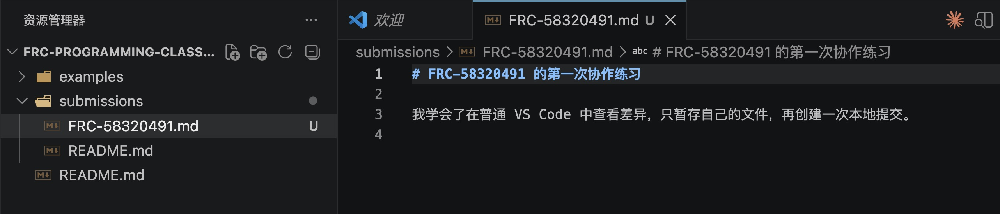
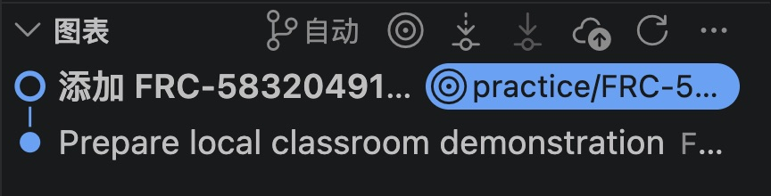

# FRC 编程环境安装与 GitHub 协作教程

更新：2026-11-13 · 适合第一次使用编程工具的同学

[课堂仓库](https://github.com/ZaneZhang-MINXIN/frc-programming-classroom) | [作业要求](../ASSIGNMENT.md) | [下载清单](downloads.md) | [问卷星提交入口](https://v.wjx.cn/vm/YR3nxKS.aspx)

**先尝试安装、检查环境，再交截图。GitHub 的 Issue 和 PR 是选做，不会做也可以提交问卷。** 不另交 Word、PDF 或实验报告。

| 学习内容 | 本次要求 | 凭据 |
| --- | --- | --- |
| 安装 WPILib、检查 Git 与扩展 | 尝试完成，如实记录进度 | 环境截图必交；成功、报错或卡住步骤都接受 |
| Fork、修改文件、Issue、PR | 选做，按能力尝试 | 三道 GitHub 截图题均可留空 |
| 问卷星提交 | 必交 | 填姓名、学号、随机学习代号、系统并上传截图 |

手机扫码，电脑直接点上方提交入口。二维码与文字链接相同。

<a href="https://v.wjx.cn/vm/YR3nxKS.aspx"></a>

<a id="toc"></a>
## 阅读导航

1. [准备电脑，认清操作位置](#prepare)
2. [下载软件](#download)
3. [Windows / macOS 安装](#install)
4. [环境检查与必交截图](#check)
5. [选做：用普通 VS Code 完成 GitHub 协作](#github)
6. [问卷星提交](#submit)
7. [常见问题](#help)
8. [后续练习与官方阅读](#learn)

在 GitHub 网页看教程时，代码块右上角可复制整块命令；在 VS Code 中打开 `.md` 后，用“打开预览”阅读。Windows 快捷键是 `Ctrl + Shift + V`，Mac 是 `Command + Shift + V`。

<a id="prepare"></a>
## 1. 准备电脑，认清操作位置

### 先确认系统

| 电脑 | 去哪里查看 | 本课安装包 |
| --- | --- | --- |
| Windows | 设置 > 系统 > 关于，查看版本与系统类型 | Windows 11、x64；不适用 ARM 或 32 位 Windows |
| Apple 芯片 Mac | 苹果菜单 > 关于本机，显示 Apple M 系列芯片 | macOS 15 或以上，Arm64 DMG |
| Intel Mac | 苹果菜单 > 关于本机，显示 Intel 处理器 | macOS 15 或以上，Intel DMG |

系统不符合、机房限制安装或不确定芯片时，先问老师，不自行升级学校电脑。

建一个固定的练习父文件夹：Windows 可用 `D:\GitClass`，没有 D 盘就用 `C:\GitClass`；Mac 在个人文件夹中建 `GitClass`。尽量避开自动同步目录。不要把整个桌面或下载目录建成 Git 仓库。

### 这些工具各做什么

| 名称 | 用途 | 容易混淆的地方 |
| --- | --- | --- |
| WPILib | 机器人开发工具套装，带配套 VS Code、JDK 和工具 | 只装普通 VS Code 不等于装好 WPILib |
| VS Code | 编辑文件、查看修改、打开终端 | 普通版能写本次文字练习；环境检查用 WPILib 配套版 |
| Java / JDK | Java 是语言；JDK 提供编译等工具 | 本课由 WPILib 安装器准备匹配的 JDK，不另下“最新版 Java” |
| Git | 在电脑上记录版本、提交修改 | 安装 Git 不等于登录 GitHub |
| GitHub | 网上存放仓库、提 Issue 和 PR | 浏览器能登录，不代表电脑已有 Git |

### 命令到底输在哪里

| 操作 | Windows | macOS |
| --- | --- | --- |
| 命令面板：搜索编辑器操作 | `Ctrl + Shift + P` | `Command + Shift + P` |
| 终端：输入 Shell 命令 | 菜单“终端 > 新建终端”，用 PowerShell | 同一菜单，用默认 Shell |
| 保存文件 | `Ctrl + S` | `Command + S` |
| 区域截图 | `Win + Shift + S` | `Command + Shift + 4` |

`WPILib: Create a new project` 和 `Git: Clone` 在**命令面板**搜索；`git --version` 在**终端**执行；`# 标题` 写进 **Markdown 文件**。三处不要混用。

复制命令时保留英文标点和空格，一次执行一行。标有“换成自己的”的内容要先替换；不要把代码块外的说明或三反引号一起输入。

<a id="download"></a>
## 2. 下载软件

本课固定 **WPILib `2027.0.0-alpha-6`**。这是课堂指定测试版，不代表最新版本、稳定版或正式比赛方案。官网若推荐其他版本，不自行替换。

| 软件 / 平台 | 下载地址 | 选择提示 |
| --- | --- | --- |
| WPILib Windows | [官方 ISO 直链](https://packages.wpilib.workers.dev/installer/v2027.0.0-alpha-6/Win64/WPILib_Windows-2027.0.0-alpha-6.iso) | Windows 11 x64 |
| WPILib Mac Apple 芯片 | [官方 Arm64 DMG 直链](https://packages.wpilib.workers.dev/installer/v2027.0.0-alpha-6/macOSArm/WPILib_macOS-Arm64-2027.0.0-alpha-6.dmg) | Apple M 系列 |
| WPILib Mac Intel | [官方 Intel DMG 直链](https://packages.wpilib.workers.dev/installer/v2027.0.0-alpha-6/macOS/WPILib_macOS-Intel-2027.0.0-alpha-6.dmg) | Intel 处理器 |
| Git for Windows | [Git 官方入口](https://git-scm.com/install/windows) | 选 x64 安装版，不选 Portable |
| Git for Mac | [Git 官方说明](https://git-scm.com/install/mac) | 先检查，通常随 Apple 命令行工具安装 |
| 普通 VS Code | [VS Code 官方下载](https://code.visualstudio.com/Download) | Windows x64；Mac 按芯片选，已安装可沿用 |

WPILib 安装包约数 GB，下载完成后再打开。文件名应含 `2027.0.0-alpha-6`，且平台正确。Windows 可在资源管理器“查看 > 显示 > 文件扩展名”核对后缀。

GitHub 下载慢时，可在学校允许的前提下使用 [ghfast](https://ghfast.top/) 或 [GH-Proxy](https://gh-proxy.com/)。它们是第三方公开文件下载备用，不用于登录、Clone、Push、Issue 或 PR，不输入密码、验证码、Token 或私有链接。不保证速度与可用性。

WPILib 上表直链来自官方发布页，域名是 `packages.wpilib.workers.dev`，**不要再加 GitHub 代理前缀**。完整 URL、加速示例和 SHA256 命令见 [下载清单](downloads.md)。

官方对照：[Alpha 6 发布说明与校验值](https://github.com/wpilibsuite/allwpilib/releases/tag/v2027.0.0-alpha-6) · [WPILib 安装指南](https://docs.wpilib.org/en/2027/docs/zero-to-robot/step-2/wpilib-setup.html)。安装指南会更新，版本和系统要求以本课固定版本的发布说明为准。

<a id="install"></a>
## 3. Windows / macOS 安装

### Windows：Git

1. 运行官方 Git x64 安装器，多数选项保持默认。
2. 遇到 PATH 选项，选 `Git from the command line and also from 3rd-party software`。
3. 默认编辑器可选 Visual Studio Code；凭据助手保留 Git Credential Manager（若有此选项）。
4. 安装完成后，保存文件，关闭所有 VS Code 窗口再重开，让新窗口读取更新的 PATH。

### Windows：WPILib

1. 右键下载好的 `.iso`，点“挂载 / Mount”，打开新出现的虚拟光驱。
2. 运行 `WPILibInstaller.exe`，点 Start。
3. 选 **Everything**。个人电脑通常选 **Install for this User**；机房安装范围由管理员决定。


4. 到编辑器下载页，选 **Download for this computer only**。即使已有普通 VS Code，也安装课堂配套版，不选 Skip。


5. 等下载与安装结束，点 Finish，打开新安装的 WPILib VS Code。

图为官方文档界面示例，图中年份不替代本课版本。[图片来源与许可](assets/SOURCES.md)。

### macOS：先准备 Apple 命令行工具

在“应用程序 > 实用工具 > 终端”执行：

```bash
xcode-select --install
```

按 Apple 窗口提示安装，结束后再执行以下两行。若提示已安装，不重复安装。

```bash
xcode-select -p
git --version
```

第一行应返回开发者工具目录；第二行应显示 Git 版本。已有 Git 也要确认 Apple 命令行工具就绪，再运行 WPILib 安装器。本课不要求先装 Homebrew 或完整 Xcode。

### macOS：安装 WPILib

1. 双击匹配芯片的 `.dmg`，运行里面的 `WPILibInstaller`。
2. 选择 Everything，按提示安装配套 VS Code 与工具；下载编辑器时选 Download for this computer only。
3. 安装完成后，从安装器提供的位置打开配套 WPILib VS Code，可把它拖到 Dock 方便下次使用。
4. 不用 Windows ISO，也不用为本课另装 Windows。

遇到来源不明、安全拦截、证书警告或管理员限制时，停止并请老师核对。不要关闭杀毒软件、Gatekeeper、HTTPS 校验或学校管理策略。

<a id="check"></a>
## 4. 环境检查与必交截图

检查时使用 **WPILib 配套 VS Code**，不是普通版。先不连接机器人，也不创建机器人项目。

1. 打开“终端 > 新建终端”，执行：

```sh
git --version
```

2. 打开左侧扩展面板，在搜索框输入：

```text
@installed WPILib
```

3. 确认 WPILib 扩展存在且已启用。打开命令面板，搜索：

```text
WPILib
```

4. 能找到 `WPILib: Create a new project` 等命令就行，不必点击执行。
5. 保持底部 Git 版本结果可见，再打开命令面板，截取同一画面中的两处结果。

| 你的情况 | 问卷第 5 题交什么 |
| --- | --- |
| 检查通过 | Git 版本结果 + WPILib 命令面板 |
| 安装或检查报错 | 清楚的报错画面，保留相关操作位置 |
| 下载、权限或其他步骤卡住 | 当前卡住的步骤画面；不用伪造成功结果 |

只截必要区域，遮盖个人路径、邮箱和无关标签页；需要补充画面可用问卷第 10 题。**不会做后面的 GitHub 练习，可以直接去[提交问卷](#submit)。**

看到扩展和命令，只说明基础工具可加载，不代表具体机器人工程构建成功。`java -version` 也不能单独证明 WPILib 的 JDK 配置正确。本次不要求部署或驱动机器人。

<a id="github"></a>
## 5. 选做：用普通 VS Code 完成 GitHub 协作

这一部分可以分次尝试。以下截图是老师在 Mac **普通 VS Code** 中实际编辑、暂存、提交的示范，不是学生完成凭据，也没有示范远程推送。Windows 按上文使用对应快捷键，不必照装截图里的其他插件。

### 5.1 账号、随机代号与邮箱

使用符合 GitHub 年龄要求和学校安排的本人账号；不能注册或网络受限时，保留进度截图交问卷，不借用账号或绕过限制。

GitHub 用户名自起昵称；另选一个 `FRC-` 加 **8 位随机数字**的学习代号，不用找老师领取。不要用姓名、学号、生日、班级座号或电话尾号。到教师仓库的 `submissions` 和 Issues 搜索是否重号，重号就换一个。

本教程的 `FRC-58320491` 是老师示例，**不要照抄**。后续文件、分支、Issue、PR 和问卷使用同一代号。

在 GitHub 头像 > Settings > Emails 中，开启 `Keep my email addresses private`，复制页面实际提供的 `noreply` 邮箱。若有 `Block command line pushes that expose my email`，可开启。不要截图公开这一页。

姓名、学号只填给老师的问卷，不写进公开 GitHub。代号不保证匿名，用户名、头像和历史活动仍可能关联身份。详见 [隐私说明](../PRIVACY.md) 和 [GitHub 提交邮箱官方说明](https://docs.github.com/en/account-and-profile/how-tos/email-preferences/setting-your-commit-email-address)。

### 5.2 Fork，再 Clone 自己的副本

1. 打开[教师仓库](https://github.com/ZaneZhang-MINXIN/frc-programming-classroom)，点右上角 **Fork**。
2. Owner 选自己的账号，仓库名保持不变，可只复制 `main`，点 Create fork。
3. 跳转后，核对地址拥有者已经变成自己的用户名。
4. 在**自己的 Fork** 点 Code > HTTPS，复制克隆地址。不用 Download ZIP。
5. 打开普通 VS Code，在命令面板运行 `Git: Clone`，粘贴地址。
6. 选择准备好的 `GitClass` 父文件夹。克隆后点 Open，打开自动生成的 `frc-programming-classroom` 子文件夹。
7. 若弹出工作区信任提示，确认来源是本课仓库后再选择信任。在新终端执行：

```sh
git status
git remote -v
```

应能看到仓库状态；`origin` 的 fetch / push 地址都应指向**自己的 Fork**。若指向教师仓库或提示 `not a git repository`，先看[常见问题](#help)，不要执行 `git init` 补救。

| 操作 | 从哪里到哪里 |
| --- | --- |
| Fork | 教师 GitHub 仓库复制到你的 GitHub 账号 |
| Clone | 你的 Fork 克隆到电脑 |
| Push | 电脑上的提交推到自己的 Fork |
| PR | 申请把自己的改动合并进教师仓库 |

官方阅读：[Fork 与克隆](https://docs.github.com/en/pull-requests/how-tos/work-with-forks/fork-a-repo)。

### 5.3 设置本仓库的提交身份

先确认终端位于刚克隆的仓库。下面两行**替换后再逐行执行**：第一行改成自己的代号；第二行引号内换成刚才复制的完整 `noreply` 邮箱，不能原样输入中文占位说明。

```sh
git config --local user.name "FRC-58320491"
git config --local user.email "换成自己的完整GitHub noreply邮箱"
```

再核对 Git 实际使用的作者身份：

```sh
git var GIT_AUTHOR_IDENT
```

结果应是自己的代号与 `noreply` 邮箱。不正确就先停止提交，请老师检查。此结果只在自己电脑上看，不截图公开。`--local` 只设置当前仓库；修改配置不会清除旧提交里的姓名或邮箱。

### 5.4 创建练习分支

1. 点击 VS Code 左下角的 `main`。
2. 选 Create new branch / 创建新分支。
3. 输入 `practice/自己的学习代号`，例如 `practice/FRC-58320491`。
4. 如询问起点，选择 `main`；左下角应变成自己的练习分支。

<details>
<summary>需要时展开：创建分支的终端方法，与界面方法二选一</summary>

先替换为自己的代号，不要把同一分支创建两次：

```sh
git switch -c practice/FRC-58320491
git branch --show-current
```

分支已存在时，选择已有分支，不重复创建。

</details>

### 5.5 新建一个 Markdown 文件

1. 打开 `examples/FRC-EXAMPLE.md` 看格式，不修改示例。
2. 在左侧 `submissions` 文件夹上右键 > New File / 新建文件。
3. 文件名为 `自己的学习代号.md`，如 `FRC-58320491.md`，不要变成 `.md.txt`。
4. 复制下面的文件内容，替换代号与学习句子，写自己实际学到的操作，再保存。

```markdown
# FRC-58320491 的第一次协作练习

我学会了创建练习分支，并把一次提交推送到自己的 Fork。
```

这里的 `#` 加空格是 Markdown 标题，写在文件里，不是终端命令。文件路径应为 `submissions/自己的学习代号.md`。不要改其他同学的文件、教程或模板，不添加截图。



实拍 1：左侧是文件位置，右侧是保存后的内容。[图中原文](../examples/FRC-58320491.md)只作对照，不原样交作业。

### 5.6 保存、暂存、Commit

1. 点击左侧“源代码管理”图标，找到自己的文件，点开检查差异。
2. 新文件旁的 `U` 表示尚未跟踪，不是报错。绿色通常表示新增，红色表示删除。


实拍 2：核对更改列表，只处理自己的文件。

3. 点**自己文件这一行**的 `+`，它会移到“暂存的更改”。不点“全部暂存”或“放弃更改”。
4. 在消息框写清这次修改，如 `添加 FRC-58320491 的第一次练习`，点 Commit / 提交。


实拍 3：文件已经暂存，核对文件名再提交。

5. 如果打开 `COMMIT_EDITMSG`，在第一行写说明、保存并关闭该标签页。等待提交结束后，执行：

```sh
git status
git log -1 --oneline
```

应看到工作区干净，以及刚刚的提交记录。



实拍 4：已产生本地提交，**还没有上传**。这组示范没有连接远程或代学生创建 Issue、PR。

| 操作 | 实际结果 | 上传了吗 |
| --- | --- | --- |
| Save 保存 | 写入电脑文件 | 没有 |
| Stage 暂存 | 选出这次要提交的修改 | 没有 |
| Commit 提交 | 记入电脑上的 Git 历史 | 没有 |
| Push 推送 | 把提交发到远程 | 有 |

官方阅读：[VS Code 源代码管理](https://code.visualstudio.com/docs/sourcecontrol/overview)。

### 5.7 Push 到自己的 Fork

1. 在源代码管理中点 **Publish Branch / 发布分支**；没有此按钮时，从 `...` 菜单选 Push / 推送。
2. 如询问远程，选指向自己 Fork 的 `origin`。
3. 需要认证时，按提示在官方 GitHub 页面登录本人账号。不要把密码或 Token 写进文件。
4. 到自己 Fork 的网页，切换到 `practice/自己的代号`，打开 `submissions`，确认自己的文件与提交已出现。

若看到“Publish to GitHub”并要求新建仓库，先取消，检查是否打开了正确的克隆目录。网页停留在 `main` 时看不到练习分支的文件，先切分支，不要重复创建文件。

<details>
<summary>需要时展开：首次推送的终端备用方法</summary>

确认 `origin` 是自己的 Fork，把分支名改成自己的后执行：

```sh
git push -u origin practice/FRC-58320491
```

`-u` 设置当前分支的远程跟踪关系，以后同一分支通常可直接 Push。

</details>

### 5.8 在教师仓库提 Issue

1. 打开[教师仓库 Issues](https://github.com/ZaneZhang-MINXIN/frc-programming-classroom/issues)，点 New issue。
2. 选“课堂提问或建议”表单，按提示填代号、问题类型、问题与已经尝试的内容。
3. 标题包含自己的代号与主题，例如：

```text
[课堂练习] FRC-58320491 Commit 后为什么还要 Push
```

说明“哪一步、看见什么、想知道什么”，或提出具体改进建议。没有报错可以提真实的概念问题，不编造故障，也不只写“已完成”。

检查没有身份资料、凭据或截图，勾选隐私检查并发布。记下 Issue 编号，复制链接备用。不必等老师回复。

官方阅读：[创建 Issue](https://docs.github.com/en/issues/tracking-your-work-with-issues/using-issues/creating-an-issue)。

### 5.9 向教师仓库发 PR

在自己的 Fork 切到练习分支，点 Compare & pull request。没有提示时，进入教师仓库 Pull requests > New pull request > compare across forks。

| 字段 | 正确选择 |
| --- | --- |
| base repository | `ZaneZhang-MINXIN/frc-programming-classroom` |
| base | `main` |
| head fork / head repository | 你自己的 Fork |
| compare | `practice/自己的学习代号` |

方向是**自己的练习分支合并到教师 `main`**，不要反过来。

1. 查看差异，应只新增自己的 `submissions/代号.md`。出现无关文件或大量删除时先停止。
2. 标题写自己的代号与修改主题，例如 `[课堂练习] FRC-58320491 完成第一次提交`。
3. 按自动出现的模板填代号、文件路径与检查结果。有 Issue 就粘贴链接；没做 Issue 如实写“暂未完成”，不编造链接。
4. 点 Create pull request。创建后打开 **Files changed**，再次确认只改自己的一个文件。

PR 显示 Open 或 Merged 都可以交凭据，不必等老师合并。后续老师要求修改时，在**原分支**修改、保存、暂存、Commit、Push，原 PR 会更新，不用另开。

官方阅读：[从 Fork 创建 PR](https://docs.github.com/en/pull-requests/how-tos/create-pull-requests/creating-a-pull-request-from-a-fork)。

<a id="submit"></a>
## 6. 问卷星提交

打开 **[FRC 作业提交问卷](https://v.wjx.cn/vm/YR3nxKS.aspx)**，或扫描本页开头二维码。详细题目与截图清单见 [作业页](../ASSIGNMENT.md)。

| 填写顺序 | 内容 |
| --- | --- |
| 第 1 至 4 题 | 姓名、学号、随机学习代号、电脑系统；学号开头的 `0` 要保留 |
| 第 5 题，必填 | 环境检查成功、报错或卡住步骤的截图 |
| 第 6 至 8 题，选填 | Issue、PR 概览、PR 的 Files changed 截图；不会做可以留空 |
| 第 9 题，必填 | 看清提交确认，确认如实记录进度并检查隐私后勾选 |
| 第 10 题，选填 | 补充截图 |

每道上传题 **1 个文件、最大 10 MB，仅 PNG / JPG / JPEG**。一张图装不下就用补图题，不拼成文字看不清的长图。

截图只交问卷，不放到公开仓库、Issue、PR 或 Fork。可用 `代号-环境.png` 等文件名，不用姓名或学号命名。裁掉无关窗口、聊天和标签页，遮盖个人路径、邮箱及账号凭据。

点击提交，看到成功提示后保留原始截图。成功提交不代表已经批改；没有完成 GitHub 选做也可正常提交，不需要声称已经全部做完。

<a id="help"></a>
## 7. 常见问题

| 现象 | 先检查什么 |
| --- | --- |
| 找不到 `git` | Windows 确认 Git 已安装，关闭所有 VS Code 再重开；PowerShell 可用 `Get-Command git` 检查。Mac 检查 Apple 命令行工具 |
| 找不到 WPILib 命令 | 是否开成普通 VS Code；扩展面板搜索 `@installed WPILib`，确认启用 |
| `not a git repository` | 打开克隆后的 `frc-programming-classroom` 文件夹，不是 `GitClass` 父目录；不要执行 `git init` |
| `Author identity unknown` | 按 5.3 设置本仓库的署名与邮箱，不用重新注册 |
| 文件变成 `.md.txt` | 显示扩展名，改为真正的 `.md`；确认放在 `submissions` |
| Commit 后网页没变化 | Commit 仅在本地；Push 后到自己的 Fork，切到正确练习分支 |
| Push 报 `403` / `permission denied` | `git remote -v` 中 `origin` 是否为自己的 Fork，认证账号是否正确 |
| Push 被 `rejected` | 记录原提示，请老师指导整合；不用 `--force`、`reset --hard` 或删除文件解决 |
| PR 没有差异 / 出现很多文件 | 核对 Push、base、compare 与暂存范围；已合并过的改动也可能没有新差异 |
| 网络、账号或安装卡住 | 保留相关画面，按实际进度交问卷；不共享账号或关闭安全设置 |

求助时说清“本教程哪一步、刚做了什么、提示原文是什么”。私下展示必要画面；公开 Issue 不粘贴含个人路径或凭据的完整日志。

<a id="learn"></a>
## 8. 后续练习与官方阅读

<details>
<summary>选学：下次怎样取得老师的仓库更新</summary>

自己的改动先保存、提交并推送，确认工作区干净。到自己的 Fork 网页切到 `main`，点 Sync fork，把教师 `main` 的更新同步进来；回到本地切到 `main`，再 Pull。出现冲突或“丢弃提交”提示，先找老师。

`origin` 是自己的 Fork。同步 Fork 和本地 Pull 是两步，下次练习从更新后的 `main` 创建新分支。不必每次重新克隆。

</details>

<details>
<summary>选学：按老师安排构建真实机器人工程</summary>

本仓库只有协作练习，不是机器人控制工程。打开老师已核对的工程根目录，通常能看到 `build.gradle`、`gradlew`、`gradle` 与 `.wpilib`。

等待扩展加载，在命令面板运行 `WPILib: Build Robot Code`；输出 `BUILD SUCCESSFUL` 才说明这次具体工程构建成功。Build 在电脑上构建，Deploy 会上传到机器人，本次不要求 Deploy。

设备镜像、WPILib 版本与厂商库由老师统一核对。不自行刷镜像、混换 Alpha 或复制旧年份依赖；没有老师明确指令，不连接、部署、启用或驱动机器人。

官方资料：[Systemcore 测试与兼容信息](https://github.com/wpilibsuite/SystemcoreTesting)。

</details>

按当前问题挑一份读，不用一次读完：

| 想继续学什么 | 官方资料 | 先看什么 |
| --- | --- | --- |
| 安装细节与版本要求 | [WPILib 安装指南](https://docs.wpilib.org/en/2027/docs/zero-to-robot/step-2/wpilib-setup.html) | 系统要求、安装器选项；不要照着换掉课堂固定版本 |
| 用 VS Code 写 Markdown | [VS Code Markdown 文档](https://code.visualstudio.com/docs/languages/markdown) | 标题导航、预览、链接 |
| Markdown 排版 | [GitHub 基础语法](https://docs.github.com/en/get-started/writing-on-github/getting-started-with-writing-and-formatting-on-github/basic-writing-and-formatting-syntax) | 标题、列表、链接、图片、任务清单 |
| 可复制的代码示例 | [GitHub 代码块语法](https://docs.github.com/en/get-started/writing-on-github/working-with-advanced-formatting/creating-and-highlighting-code-blocks) | 三反引号与语言标记 |
| 版本记录到底是什么 | [Pro Git 中文版](https://git-scm.com/book/zh/v2) | 第 1 章概念、第 2 章基础；命令中的身份信息按本课隐私要求设置 |
| Java 入门 | [Dev.java 官方教程](https://dev.java/learn/) | Your First Steps、Language Basics；学习语法不等于要更换课堂 JDK |

[返回阅读导航](#toc) | [查看作业清单](../ASSIGNMENT.md) | [提交问卷](https://v.wjx.cn/vm/YR3nxKS.aspx)
